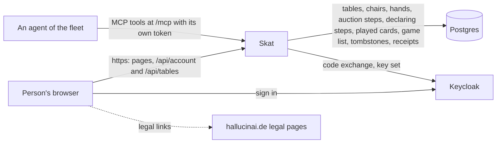
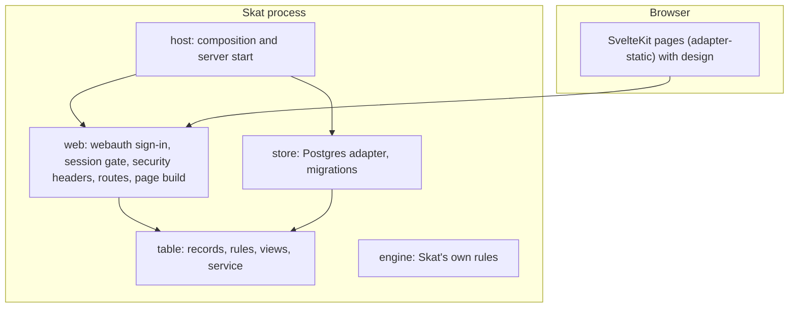
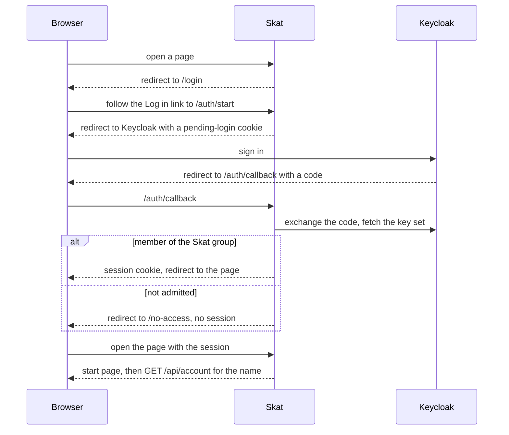

# Skat architecture

## 1. Context and Scope

Skat serves a small circle of signed-in people in a browser. Outside it: the agents of the fleet, which open tables, take chairs and play at Skat's `/mcp` under a token of their own (see Trust); the realm's identity provider (Keycloak), which signs people in, says who belongs to the Skat group and signs the agents' tokens, Skat's own Postgres database, which holds tables, chairs, dealt cards, auction steps, the declarer's steps, the cards played, the table's list of played games, a tombstone row for a table that ended, the rule sets people saved, the invitations to agents and command receipts, and the fleet's central legal pages at hallucinai.de, which the page links and which hal composes from each app's own part; Skat's part lives in `legal/` and hal reads it from each release. Skat builds on the fleet stack, FastAPI and Svelte with webauth for sign-in and design for the shared look, and takes a maintained library before writing its own code. Accounts and sessions are not in the database; they stay in memory.

## 2. Building Block View

One process serves the static SvelteKit build and the few API routes. It refuses to start without the build and without a database at the newest migration.

- **`skat.host`** composes the app from settings and the page build, and starts uvicorn.
- **`skat.web`** is the adapter: webauth's sign-in routes and session gate, the security headers, the account routes, the call origin route (`/api/call-origin`), the table routes under `/api/tables`, the rule-set routes under `/api/rule-sets` (saving and reading are tools, deleting one is none), `/health` and the page build, whose `/t/{id}` page opens a table by its link. It decides nobody's rights beyond admission: who may call an agent to a table is decided in `skat.table` from facts the web gathers (`web/calling.py`). `web/mcp.py` owns the MCP front: it builds the protected resource and the front from the agents library. Every route carries the mark of a tool or an exclusion with its reason, and an undecided route stops the build. The front carries one tool that is not a route, `accept_invitation` in `web/member_place.py`, because its arguments are the agents library's and not a route's body; that module also serves the agent's standing as the resource `member://standing` and tells a listening agent, after the commit, that its standing changed.
- **`skat.table`** is the table core: records, the rules that decide a command (a stand-up or a send-away opens a chair of a running hand, and every hand command is then refused `seat-open` until someone sits in it; an account that left a chair of the running hand may sit again only there, else `own-seat-only`, by a mark on the hand's progress that ends with the hand), the views a person is allowed to see, and a service that runs each command as one transaction through a narrow port. A person's saved rule sets (`table/rule_sets.py`) are no table: their own small service and port save, list and delete the sets of the account that acts. Each phase of a hand and each house rule with a table step is one module per layer (`table/auction.py`, `store/auction.py`, `web/auction.py`; `table/kontra.py`, `store/kontra.py`, `web/kontra.py`) with one short method on the command runner, and `HandProgress` holds what the phases recorded. Refusals have one owner per token: `Refusal` holds the table's own reasons and the engine's enums hold theirs, and one parser reads a stored token back. A table is a member place (`table/member_place.py`): an agent is a member exactly while it holds a chair there (`active`) or an invitation to it is open (`invited`), so the stored book holds only open invitations and each agent's epoch per table, and the standing is derived from the chairs and the book, with no stored state to keep in step when a chair is freed. It imports no framework, driver or adapter.
- **`skat.engine`** holds Skat's own rules as pure code below the table. The table calls its deck, its deal and its bidding: the third sit draws the first dealer and deals the hand, a seated player's bid runs through the engine's auction, the declarer's steps through its declaration, every card through its tricks (a declared game's and, at a table with Ramsch, a Ramsch's, which `ramsch.py` plays and reckons, after the stage of takes and pushes that `schieberamsch.py` replays at a table whose Ramsch has pushing), every word of Kontra through `kontra.py`, which replays a hand's stored words against the cards each followed and prices the doubled list score, a declarer's give-up, at once or with an opponent's yes, an opponent's give-up with the declarer's yes, and either side's throw-down through its giving-up rules, the Bock rounds through `bock.py`, which meets a table's triggers once at each hand end (a played, given-up or thrown-down game after its entry exists, a passed-in hand and a played-out Ramsch, which meets `passed-in` and no other trigger of a game) and prices the pending games' factor, and the trick that ends the game, the tenth or the one that decides a Null or Schwarz-announced game, through its valuation and settlement. It imports no framework, driver or adapter.
- **`skat.store`** implements those ports on Postgres with SQLAlchemy and psycopg 3, and owns the Alembic migrations. `skat migrate` takes an advisory lock and upgrades the database before any other setting or the page build is read; `skat serve` never migrates and refuses a database that is not at the newest migration. Migrations only expand. A chair keeps its occupant's kind, `person` or `agent`, in `chairs.occupant_kind`, set exactly while the chair is occupied. The option columns of a table (`show_running_points`, the three Kontra columns and the two Bock columns and the four Ramsch columns with the optional `ramsch_pushing`, with their checks) have one owner, `option_columns` in `store/schema.py`, which `tables` and `rule_sets` both use, and `options_of` and `option_values` are the one mapping between those columns and `TableOptions`; `rule_sets` holds per set its id, its owner's account id, its name (unique per owner) and the option columns. A table keeps its dealer in a column and its dealt hand in a card table with one row per card, whose key holds each card once per table and whose `holder` column names the position or the skat; the third sit stores both with its chair and receipt. The auction is `auction_actions`, one row per accepted step and ordinal, and the table reads it back by replaying the steps through the engine; a save whose stored steps are no prefix of the new ones raises, so an earlier step cannot be rewritten, and a stored log the engine refuses raises at the next command. The declarer's steps are `declaring_steps`, the same pattern with one row for a take, a put-back or a declaration; taking the skat changes no `hand_cards` row, and `save_table` raises when the hand it is given differs from the one dealt while the hand has progress, so the deal stays as dealt. The words of Kontra and Re are `kontra_words`, one row per word with its position and how many cards were played before it, deleted with the hand like the cards; the table replays them per hand, so a word is judged against the cards it followed and never against another hand's. A seat's answer that it says no word now (`say_no_word`) is `kontra_no_words`, one row per position and word, no part of that log and unseen by the engine: the word stays sayable until its deadline, a chair that changes hands takes its seat's rows, and the rows go with the hand. The cards played are `played_cards`, one row per card and ordinal, with a unique key that holds each card once per table; the trick is derived from the ordinal and never stored, and the table replays the rows through the engine as well. The third pass, the card that ends the game, the declarer's give-up, an opponent's yes to it, the declarer's yes to an opponent's give-up and a side's throw-down are the six changes of the stored hand that do not raise while the hand has progress. At a table without Ramsch the third pass ends the hand: its cards are deleted in that transaction, and its steps stay until the next deal replaces them, because the view between hands reads the passed-in fact from them. A hand passed in has no declarer, so it has no declaring steps. At a table with Ramsch the third pass keeps the hand and starts a Ramsch, whose cards go into `played_cards` like any game's and whose thirtieth card ends it. At a table whose Ramsch has pushing the third pass starts the stage first: each seat's take, put-back (with its two cards) and push is a row of `pushing_steps` (the key holds the ordinal, a check holds the position to the vocabulary of `hand_cards`), replayed through the engine like the other logs, and the stage's cards are those the replay leaves, never a rewrite of the dealt hand; the log is deleted with the hand's other logs when the Ramsch ends. The card that ends the game, the thirtieth or the one completing the deciding trick, the declarer's give-up, an opponent's yes to it, the declarer's yes to an opponent's give-up or a side's throw-down, ends a played hand: the record it leaves has no hand and empty progress, and its game joins the table's list, `TableRecord.game_list`, which outlives every deal of its series and holds only the table's current series (`tables.series_number`): the stored rows of an earlier series stay as the table's history, and no path deletes a finished game. `save_table` tells this end apart from a passed-in one by the longer list, and in that transaction one named step deletes the table's rows in `hand_cards`, `auction_actions`, `declaring_steps`, `pushing_steps`, `played_cards`, `kontra_words` and `kontra_no_words` before `game_list` gains the new row. `tables.bock_rounds` holds the pending Bock games, one count per round and empty without Bock, written with every hand's end. `game_list` is keyed by table, series number and ordinal (the ordinal counts from one in each series), keeps the series number the table held when the game was written and `finished_at`, the instant of the saving command (null for a row stored before it was kept), says by `kind` whether an entry is `declared` or a `ramsch` (one check per kind says which columns it fills; a Ramsch entry holds each seat's counted points and score, the Durchmarsch seat, the Jungfrau, the Bock factor its scores ran under and the unseen pushes of the skat, `pushes`, whose factor the table's rule derives), and holds the three seated accounts by seat and their display names with every number of the entry (its score already multiplied by the Bock factor and doubled by the words, the factor, and the last word said): the game's value and settlement from the engine, the bid from the auction and the declarer's points from the played tricks, and how the game ended with the seat that did it (`ending`, one of `played-out`, `given-up` and `thrown-down`, and `ended_by_seat`, null exactly when it was played out, tied by a check; a Ramsch row is always `played-out`). The table layer records both when it decides the end, because the engine's ending cannot tell a give-up from a game its points decided, and a consented give-up names the seat that asked, not the one that said yes; rows stored before read `played-out` with no seat; a save whose list does not continue the stored one of its series raises, as the step logs do; `read_game_list` selects the rows whose series number is the table row's, so the table sees only its current series and a next series' first deal writes nothing to the list. A give-up request, the declarer's below nine cards or an opponent's at any moment, is stored in `tables.give_up_asked_by` and `tables.give_up_declined_by`, the asking position and the opponent who said no to the declarer's, written from the record with every save, so a card, an ended hand and a deal clear them without a delete of their own. The accounts that held a chair of the running hand and left it are `chairs.held_in_hand`, one list per chair, written from the record with every save, so a deal and an ended hand clear it the same way. Every deal goes through one owner, `dealt` in the rules, which empties the hand's progress. A table that ends keeps its `tables` row as a tombstone (`ended_at`, `end_reason`, `empty_seconds`, the dealer cleared and the version bumped once), whose key keeps the id from being issued twice; `end_table` is the one step that deletes the table's rows in `chairs`, `hand_cards`, `auction_actions`, `declaring_steps`, `pushing_steps`, `played_cards`, `kontra_words`, `kontra_no_words` and every receipt of it but the create receipt, and never a `game_list` row, so a create retry still finds its table. A tombstone reads as `EndedTable`, and a command that locks a table finds none there. The invitation book is `member_book`, one row per table and agent account with the epoch (raised only by a send-away) and the four columns of one open invitation (its id, its expiry instant, its owner's account and its inviter's account), all set or all null; `end_table` deletes the table's rows with the chairs.
- Layer rule: `host` depends on `web` and `store`, which stand side by side and know nothing of each other, and both depend on `table`, and `engine` sits below `table`; never the other way. import-linter enforces it, and a second contract keeps `skat.table` and `skat.engine` free of SQLAlchemy, psycopg, FastAPI, Starlette, webauth, the agents library and the MCP SDK.
- **The frontend** (`frontend/`) is built to `src/skat/web/build`. The path constants it needs are generated from the Python constants. Sound is Web Audio code with no files: `frontend/src/lib/sound.ts` is the engine, which plays voices through a narrow audio port and knows nothing of the game, `webAudio.ts` is the port's one adapter, and `tableSound.ts` is the one place that turns the cues of `cues.ts` into sound; the context starts at the player's first tap, and a table the page did not see change sounds nothing. The player's mute lives in the browser's `localStorage` under the key `skat.settings`, owned by `frontend/src/lib/settings.svelte.ts`: `tableSound.ts` reads it through that store when the page's sound is made, nothing else reads `localStorage`, and no request carries it.

## 3. Runtime View

### A framed table signs in through a separate window

The call's frame cannot take the person to the issuer, which refuses to be framed, and its sandbox lets no framed page submit a form. A signed-out visit to `/t/{id}` with `mode=call` (`CALL_MODE`) therefore leaves the gate for `/login`, which answers 303 to `/login/call` with the same `next`; every other return address gets the plain sign-in page. The call sign-in page reads `next` from its own address and keeps only an id that matches `TABLE_ID_PATTERN` under `TABLE_PAGE_PREFIX`; anything else leaves the plain `/auth/start` link and opens no window. The face's legal links open in a new tab, because the legal origin refuses to be framed, and start no account check; its "Log in" before the page's script has run reloads the face.

"Log in" opens `/auth/start` in a separate window that returns to the plain table, and the frame shows that sign-in runs there, with a plain link that opens the table in a tab of its own. Every 500 ms the frame reads the window's address, which throws while the window shows another origin. The window ending at the table closes and the frame reloads into the call-mode table; ending at `/no-access` closes it and the frame shows No access, without a log-out action, because a log-out would end the person's session in the call too. A window closed first leaves the frame to ask `/api/account`: a 200 brings the table, anything else shows the sign-in face with a notice and asks again every 2 s for 3 minutes, which also covers a sign-in finished in the plain link's tab. The sign-in face sends and reads no message to the call, and `window.open` returning null leaves the plain link as the way on. `frontend/src/lib/callSignIn.ts` owns these decisions.

A framed call-mode table page (`isFramedInCallMode`) shows its wordmark as text and offers neither „Link kopieren“ nor „Neuer Tisch“, so no tap leaves the call mode and the call, which already shares the table, opens no public one.

### A framed table greets the call and drops its own bar

The framed call-mode table asks the signed-in route `/api/call-origin` for the configured call origin (null when unset), posts one `ready` (`v`, `type`, and the table id of its own address) to exactly that origin, never `*`, and takes the first valid `hello` after it. That `hello` drops the page's own bar and removes the page's message listener, so no later message is read, and the stage then takes no tap for one second because the table moves up; a call that never greets leaves the bar. A message counts only when it comes from the parent window, from the call origin byte for byte, as a plain object with exactly the keys `v`, `type`, `attachment` and `attempt`, version 1, a positive safe integer attachment and a null attempt; the exact key set is the size bound, and an ignored message leaves no trace. A route that fails or answers anything but 200 counts as no origin, and no `ready` goes out. A greeting changes only the page's own surroundings: nothing in it reaches the DOM, a request or storage, and the page's commands keep their own session and checks. A reload is a new document and greets again; a top-level page, a framed page without the call mode and the sign-in face post nothing. `frontend/src/lib/callFrame.ts` owns these decisions.

An agent's tool call is one in-process request into the whole app. The agent presents its bearer token at `/mcp`; webauth's bearer gate admits it before routing, creates its own account (kind agent) on its first token, and the front answers `tools/list` and `tools/call` at revision 2026-07-28 alone. A call runs the marked route with the same token, so every middleware, the rate limit and the route's own checks apply as for a browser, and the route reads its actor from the admitted account. A refusal of the route comes back as a failed tool result with its reason.

Opening a table is one transaction: the service looks up the receipt under (account, command id), decides with a random 128-bit table id, writes the table with its opener in chair 1, its version and the receipt, and commits. The same command id with the same request returns the first table; another request under it is refused; two identical requests at once end with one table, because the receipt's key is unique and the loser's transaction rolls back and replays the winner's.

### The live view of a table

An open table page holds one server-sent-events stream (`GET /api/tables/{id}/events`, Starlette's streaming response). Admission is the session gate's at open, and an id that is no table is a plain 404 before anything is held open. A stream registers itself in `skat.web`'s in-memory presence registry, then reads and sends the full view built for its own account with `view_of`, then sends a fresh view after each change; no message names an account id or a watcher. The page shows the first view of a table it read once, then lets each message replace it. A page that reads or receives the ended view shows why the table closed, with the stored wait, and keeps no stream open: `watchTable` closes its stream on that message, and a first read that already answers `ended` opens none.

- **Presence is process-local.** The registry keys connections per table and account, so an account in two tabs is one watcher; the count is the connected accounts without a chair. It lives only in this process, which is the one replica Skat runs as, and is never stored.
- **An agent's lease is its presence.** An agent holds no stream, so every admitted call at `/mcp` renews a lease of `LEASE_SECONDS` (the fleet's value, from the agents library) for its account, and a lease counts the agent as connected at the tables where it sits: `TableService` takes who is present at a table from the pure rule `present_at`, the open streams plus the live leases of that table's occupants, so a lease never keeps another chair, its owner's included, alive. One timer per lease re-arms itself to the lease's end. When a lease starts, its tables' streams are woken and their next deal is asked for; when it lapses, the agent is away as a person is: the streams are woken, a chair hold starts and a table with no stream open waits afresh for its end, and a pending hold frees nothing while a lease runs, and nothing at a table on which a hand was dealt. A chair an agent takes while its lease runs counts at once, because the tool's route notes it (see the empty-table timer). Both read the agent's tables once and retry together after a failure. An agent has no move deadline: a silent agent keeps its chair at a dealt table until it stands up, is sent away or the table ends. Only calls at `/mcp` renew, and only an agent's; a call made straight at a marked route does not. Leases are not stored: after a restart every chair has its full hold, and an agent's next call starts its lease. A non-seated agent counts as nothing.
- **An away member's chair is freed by a timer per leave.** When an account's last stream on a table ends, presence records the leave on a monotonic clock and asks the event loop for one check after `SKAT_CHAIR_HOLD_SECONDS`; a returning stream clears the record. The check frees the chair only while that leave is still the account's latest and only at a table on which no hand was dealt, through `TableService.free_chair`, which runs off the event loop and wakes the table's streams after its commit. At a dealt table the check is refused, writes nothing and is not repeated: a dealt table keeps every chair, in every phase and between games, until its holder stands up, an agent's chair is sent away or the table ends. A failed freeing wakes nothing, is logged by error type and is checked again after a fixed delay until it commits. Leave times are not stored: at start, every occupied chair counts as just left, so a restart never frees a chair early and delays the freeing by at most one hold plus the outage. Shutdown cancels every pending check. The freeing's worker checks, once it holds the table's row, that the leave is still the latest and the server still runs, and a reconnect before that check keeps the chair; one after it awaits the commit on the event loop, never blocking it, and finds the chair freed. Shutdown starts no further freeing and waits, without blocking the event loop, for a write whose check already passed to end its transaction. A sweep would need a tick and free late, so the hold uses none.
- **The server frees a chair as a command with no actor.** `free_chair` locks the table's row, first asks the pure guard `hold_frees_chair` (no hand was ever dealt, the stored dealer) and then the same pure decision as standing up (the chair is freed only while the account still holds it and no hand runs), writes the chair and bumps the version in one transaction; a refusal writes nothing, bumps no version and wakes nobody. It authorises nothing and writes no receipt: it carries no command id, and a repeat finds the chair already free and changes nothing. It and the next deal are the commands with no receipt.
- **A table on which no hand was dealt ends by a timer per table.** Presence, which does not know whether a hand was dealt, starts one wait of `SKAT_EMPTY_TABLE_SECONDS` for a table when it is created, when its last stream ends, when a stand-up frees a chair at a table with no stream open while a lease runs (a full wait from the stand-up, whatever wait was pending) and, for every undealt live table, when the server starts, with what is left of it; a stream that opens ends the wait, so the pending timer finds itself superseded. When the timer fires and is still the table's latest, `TableService.end_empty_table` takes the table's row lock, reads who is connected there, and ends the table through `end_table` only while its dealer column is empty (no hand was dealt) and nobody is connected; a dealt table pauses and keeps all its rows. The check runs on the same context as the next deal: the context yields nothing to decide on once the server has stopped or a stream has opened since the wait began, which ends nothing; the end stays awaited by shutdown until its commit, and writes no receipt and no actor. A failed end is logged by error type and table id and checked again after the hold's retry delay while the wait stays the latest. The wait is stored with the end, so the ended table's answer (`ended` with the reason and the whole seconds) stays true after the setting changes; the answer, a stream and a create retry under the ended table's command id all carry it, and a stream sends it as its last message. The time since when nobody has been at the table is stored in `tables.empty_since`, apart from the table record, so a command can never overwrite it: `TableService.create` writes it when the table is created, and `TableService.note_presence` writes it on the locked row, with presence read there, when its last stream ends or an agent's lease lapses (stamped unless an earlier time stands) and when a first stream opens or a lease starts (cleared, before that stream shows anything); an opening or a sit at a table with no stream open, while a lease runs, notes who is present in the same way and keeps a pending wait; it bumps no version and writes no receipt, and the sit that deals the table's first hand clears the time in its own transaction, so a dealt table holds none; a store failure fails an opening stream with no message or is retried after the hold's retry delay. A stream that opens after the time was up ends an undealt table instead of reviving it. At start, `TableService.resume_empty_waits` stamps every undealt live table with no time to now, ends every undealt table already past its wait before the server serves, and seeds each other undealt table's timer with what is left of its wait, so a restart never gives a table a fresh wait it had begun, and a table someone was at when Skat stopped gets a full wait from the start. The end deletes the table's rows but keeps its own row as a tombstone.
- **The next hand comes by itself after a passed-in hand.** When a command ends a hand, presence starts a table's pause from then, on the same timers as the chair hold; a pause still pending from an earlier hand is replaced and its timer does nothing when it fires, so a pending timer cannot shorten this one's. When a stream's first view finds a table passed in, presence starts a pause only if none is pending, so a stream opening during the pause neither cuts it short nor stretches it. When the pause ends, `TableService.deal_next` takes the table's row lock and deals only if the pure decision in `skat.table` holds on the locked row: no hand runs, the table has a dealer, all three chairs are occupied and all three occupants are connected at that moment, and while a played game's result is pending, or at a series' end, all three chairs are ready. Its worker reads who is connected once it holds the row, reads nothing to decide on once the server has stopped, and stays awaited by shutdown until its commit, so no deal is written after the stop. It draws through the one place a hand is drawn, bumps the version once and writes no receipt, and the streams wake after its commit; a repeat, or a table that changed meanwhile, changes nothing. A member who is away holds the deal, and their return, a stream opening or an agent's call starting its lease, starts a fresh pause. A failed deal is logged by error type and changes nothing; the next stream opening asks again. No pause is stored: after a restart none is pending, and all three connected can only become true through streams opening or an agent's call starting its lease, so no sweep is needed. A handler that dies between the last pass's commit and its scheduling heals when a stream opens or an agent's lease starts.
- **The paused list is read per account from the chairs.** `GET /api/paused-tables` and the tool `read_paused_tables` ask `TableService.paused_tables`, which scans the occupied chairs once for the caller's tables, then reads each record and its two stored facts under its shared row lock and lists it only while a hand was dealt on it and the caller still holds a chair there; an ended table is skipped. The entry projects the table's view for the caller (chairs with names and totals, game number and length, the seat on turn or a waiting result) and carries no card, account id or watcher. Beside the record the row keeps `tables.last_played_at`, written in the same `UPDATE` as the dealer by `save_table` at every deal and every accepted step of play (`is_deal_or_step_of_play` in `rules.py` decides which; a check ties it to the dealer), and `tables.opener_name`, written once by `add_table`; `end_table` clears both. The entry answers `ends_at`, the last played time plus `SKAT_PAUSED_TABLE_DAYS` days in UTC, and `opener_name`, and the list is ordered soonest end first, ties by id. It does not look at who is connected.
- **After a played game, the next hand comes once all three have tapped „Weiter“.** Each chair stores its occupant's mark (`chairs.ready`, which a check keeps off a free chair). `POST /api/tables/{id}/ready`, which an agent calls as the tool `continue_after_result`, names the result the page saw by its number in the list and marks the actor's chair; a tap for another result is refused as `stale-result`, one with no result pending as `no-result`, and one from a chair already ready changes nothing and bumps no version, so a second tab's tap is no error. At a series' end `POST /api/tables/{id}/new-series` (an agent calls it as the tool `start_new_series`; the table's list then reads empty, the stored games stay) sets the same mark, refused as `not-seated`, `no-series` or `series-not-over`. Whoever sits while a result is pending counts as ready, so that sit no longer deals at once; standing up, or a freed hold, takes only that chair's mark, and the one deal step clears every mark. After every accepted or replayed tap, after a sit during a pending result and on a stream's first view of a pending result, presence asks `deal_next` at once, with no pause, and the guard on the locked row decides: two taps that complete the marks serialise on the row lock, so the later deal finds a hand and does nothing; a member who is away delays the deal until their stream opens or, for an agent, its next call; a deal lost after its tap's commit follows the retry. Nothing of this lives in memory, so after a restart a pending result deals when the streams reopen, which every page does on load.
- **A table may run a series, and the one deal step counts it.** The opener names the length in the request that opens the table: any multiple of 3 from 3 to 99, checked in the request and by a check constraint, fixed for the table's life. `tables.series_length` and `tables.series_deals` hold it, both null for a table without a series, which plays on without a count. Every deal but a next series' first adds one to `series_deals` in `dealt`, the step every sit, tap and timer deal goes through, so a passed-in hand counts although it leaves no list row; the answer's `series` says which game of how many runs and whether the series is over. After the last game no sit deals and the next deal waits for all three „Neue Serie“ marks and all three connected; that deal starts the table's list and the count again at one, and the games of the series before stay in the store, „Weiter“ is refused as `series-over`, a sitter at the end is not marked ready, and a passed-in last game names no next dealer. The last game's result stands. Once the series is over, the answer's `series.standings` ranks every account the list ever seated by total, then more games won, then fewer lost as declarer; a full tie shares the place and the next place counts everyone above it (1, 1, 3). Each list row keeps the three seated names, so a departed person is still ranked by name. The series' last game lets every pending Bock round lapse in the same decision that ends it, so the next series starts at factor 1. A series ended early by consent, as below, lets them lapse the same way, through the one owner `bock_at_series_end` in `table/bock.py`. Between games a seated member's yes (`POST /api/tables/{id}/series-end/agree`, the tool `agree_to_end_series`) proposes ending the series, the second member's yes accepts, and the third's ends it at once with the standings so far, clears every „Weiter“ mark and deals nothing; „Neue Serie“ then starts the next series. A no (`.../series-end/refuse`, the tool `refuse_to_end_series`), the next deal or the proposer's chair changing hands clears the proposal, and a chair change of the accepter takes only the acceptance. `dealt` raises `tables.series_number` at the deal that starts the next series; the answer does not carry it. From that deal until the series' first result every occupied chair's `total` reads 0, a passed-in first hand included, while a table's first series reads null until its first result. `tables.series_end_proposer`, `tables.series_end_accepter` and `tables.series_ended_early` hold the proposal and the early end, which `series_over` and `dealt` read; the answer's `series.end_proposal` names the seats and an early end reads as `over` with `game_number` below `game_count`.
- **A table's rule options are one record, fixed when the table opens.** The opener may send `options` in the create request (a strict, closed object; without it the table plays the official rules). `tables.show_running_points` holds the first option and `tables.kontra_sayer`, `kontra_reach` and `kontra_deadline` the second, all three set or all three null, written once by `add_table` and never rewritten, and every live table's answer carries it as `options`; an ended table keeps none. With it on, `playing.running_points` gives everyone the card points each side holds in completed tricks (`Playing.tally`, which leaves out the skat); a Null game shows none. `options.kontra` makes the table play the words: who may say Kontra, how far the words go and until when (a player's own next card), all three named or none. An opponent says Kontra, the declarer Re, and up to Hirsch the Kontra opponent Supra and the declarer Hirsch; play never waits for a word. Each word doubles the game's list score once more, which the entry stores, and the standings option doubles the 50 and the 40 too, read from the table's options when a total is counted. A person may save the options under a name as a rule set; a set belongs to the account that saved it and copies nothing into a table until the client sends its options in the create request, so a table keeps its options when the set changes or goes and its answer names no set. `options.ramsch` makes the table play a Ramsch for a hand all three pass (`tables.ramsch_occasion`, `ramsch_scoring`, `ramsch_jungfrau` and `ramsch_durchmarsch`, all four set or all four null): its hand answer carries `ramsch: true`, shows no running points, and its result is a `kind: "ramsch"` result with each seat's points and score; a Ramsch is a game of a Bock round like any hand, so it uses up a pending game and its seats' scores are multiplied by the Bock factor (a Durchmarsch's too unless the table scores it flat), and its end asks the rounds, which it starts by `passed-in` and the total rule alone. `options.ramsch.pushing` (`tables.ramsch_pushing`, null or one of three rules, set only with the Ramsch) adds a stage between the third pass and the Ramsch's first card: forehand, middlehand and rearhand each in turn take the skat and put two cards back (no jack unless the rule lets jacks go) or push it on unseen, through `POST .../pushing/take`, `/put-back` and `/push` and the tools `ramsch_take_skat`, `ramsch_put_back_cards` and `ramsch_push_skat`; the hand answer carries `pushing` (the seat on turn, `choosing` or `discarding`, who finished and what the pushes so far multiply by) while the stage runs and `pushes` and `push_factor` (the same product, 1 under `no-doubling`, from `pushes_factor` in the game list) through the stage and the Ramsch's play, so the page never recomputes it; each unseen push doubles the Ramsch's score unless the rule is `no-doubling`, multiplied with the Bock factor after the division by ten and the Jungfrau's doubling (`pushes` and `push_factor` are on the result and the list row); a take, a put-back and a push are no steps of play and leave the paused list's time as the deal set it, while the list names the seat on turn. `options.ramsch.pushing.grand_hand` (`tables.ramsch_grand_hand`, null or `allowed` or `off`, set only with the pushing rule; null reads `off`, as at every table stored before) lets the seat on turn declare a Grand Hand instead of taking or pushing, before it looks at the skat, through `POST .../pushing/grand-hand` and the tool `ramsch_declare_grand_hand`; at a table that does not allow it the step is `wrong-phase`. The engine ends the stage with the lowest bid and the table plays the hand as a declared Grand Hand by that seat (`declaring_of` replays the stage's cards with the Grand Hand declared and nothing announced, so `hand.ramsch` is false, a later declaring step is `already-declared`, and the pushes made so far count for nothing): its Kontra, Bock and standings rules, its reckoning and its list entry are those of any Grand Hand at the lowest bid, a reached Schneider or Schwarz included. Nobody bid, so a table whose Kontra is for bidders only has no Kontra on it. The stage's log `pushing_steps` stores the step as the action `grand-hand`. A table opened without it, and every table stored before it, plays the Ramsch at once. `options.bock` makes the table deal Bock rounds: `tables.bock_triggers` and `bock_overlap`, both set or both null, name which hands trigger a round of the next three games and what a trigger inside a round does (append, multiply or ignore); the table's answer carries `bock` with the games still to come, capped by the games the series still deals, and the factor of the running or next game. The create receipt's payload gains `"show_running_points":true`, the `"kontra"`, `"bock"` and `"ramsch"` objects only when they are on (the `"ramsch"` object holds `"pushing":{"rule":...}` between its occasion and its scoring only when pushing is on, with `"grand_hand":"allowed"` before the rule only when it is allowed), so a receipt stored earlier still replays and a retry with other options is refused as a reused command id.
- **A command that changes a table is one locked transaction, then a publish.** A sit, a stand, an auction step, a declaring step, a played card, a word of Kontra, a give-up, the other side's yes or no to it, a throw-down, „Weiter“, „Neue Serie“ or a yes or no to ending the series early locks the table's row with `SELECT … FOR UPDATE`, looks up its receipt under (account, command id), decides purely in `skat.table`, writes the change, bumps the version and stores the receipt, then commits. A read takes the same row's shared lock (`FOR SHARE`) instead, so a writer cannot commit between its statements and it sees one moment of the table. Two sits at one table therefore run one after the other: the loser's decision sees the chair taken and is refused with the holder's name, and a retry returns the stored outcome. An auction step, a declaring step, a played card, a word of Kontra, a give-up, the other side's yes or no to it or a throw-down also carries the version the client saw: a fresh command with an older one is refused as `stale-version`, while a retry is recognised by its receipt before that check. A replay reads its receipt's table under the shared lock too, except inside a command that already holds its own table's row and would otherwise risk a lock cycle with a command at the receipt's table. Only after the commit does the web layer wake the table's streams; a refused command wakes none.
- **One loop runs every stream.** `stream_messages` (`skat.web.streams`) is one async generator per request over a source with three members: `open` registers its wake before the first read, `read` returns the whole state for the stream's account, `close` runs when the stream ends. Two sources run on it, the table view and the lobby's tables; a message carries the name of its event (`StreamEvent`) when its source has one, and the table stream's carries none. The loop sends a read only when its 16-byte digest differs from the last one sent, so a wake that changes nothing sends nothing. A source's state can change without a version change (an away mark, the watcher count), and a digest sees that too.
- **A lost wake is recovered on the heartbeat.** The loop reads again when the heartbeat deadline passes and sends the read when its digest moved, so any change of the view whose wake was lost reaches every stream within one heartbeat. An idle heartbeat with no change writes one comment line (`: `), which an event source ignores and which changes no view, presence or count, so an edge that cuts a response silent for its read timeout never cuts an idle table's stream. The deadline counts from the last item the loop yielded, so wakes that send nothing never starve the comment line.
- **A wake carries no data and goes through one wake list.** `WakeList` (`skat.web.wakes`) maps a topic, a table (`TableTopic`) or an account (`AccountTopic`), to the wakes registered for it; the composition root builds it and hands it to presence, the seating routes and the lobby route. Presence is the waker of table topics and a stream registers at a table through `Presence.subscribe`, which wakes only the others at the table; seating wakes the acting account's topic after a table is opened or a chair is taken, because an account wake is no job of presence. A stream re-reads only when its table's topic woke it or its deadline passed, so a commit at another table costs it nothing. A wake is only a signal, so a stream that falls behind finds its wakes folded into one and reads the latest state, which is its fresh snapshot. A slow client never queues anything or delays another stream. The list is used on the event loop's thread only and takes no lock.
- **The lobby stream sends an account its own tables and is no presence.** `GET /api/lobby/events` (behind the session gate, no tool) sends the event `mine`: every live table where the caller holds a chair, whatever its state, each built by `TableService.my_tables` from `member_view_of` for the caller's own chairs, so no other table reaches it, and none carries a card, a card count or an account id. The entries come in the order of what the caller has to do: tables that wait for him by `waits_on` (`WaitingCase`, decided in `table/awaiting.py`), then dealt tables where someone is present, then tables without a hand, then resting tables by their end. `ends_at` is set only for a dealt table nobody is present at. Its source registers the account's topic when it opens and, on every read, swaps its registration for one that holds that topic and the topics of the tables the index lists, before it reads their records and with no await between registering the new and dropping the old, so a commit either is in the read or wakes the stream. A table that ended, or a chair the account left, drops out of the next swap. The lobby holds no chair and no subscription: opening it changes nobody's presence, asks for no deal and ends no empty wait.
- **A stream re-admits its session.** Before each read and at every heartbeat deadline (`STREAM_HEARTBEAT_SECONDS`), it calls webauth's `admit_session` off the event loop, which also renews the session; both streams take this admission from `session_admission` (`skat.web.streams`). A refusal ends the stream with nothing more sent; a store error ends it loudly. An ended session therefore stops receiving the table within one heartbeat.
- **A refused page signs in again.** When a stream fails or ends, the page's stream reader (`frontend/src/lib/stream.ts`) asks the table's session check. On a 401 it navigates to `/auth/start` with the table as `next` and a marker query, and returns to the table without a click while the issuer's own session lives. A framed page in call mode reloads instead: the gate leads the frame to the call sign-in page, and one tap signs in again there. A refusal within a bounded window of loading a page that carries the marker reloads the table address, which the gate answers with the sign-in page, instead of navigating again. The marker is in the address, so the page keeps nothing on the device, and it removes the marker from the address once its first table request has been made. Checks run one at a time. Any other answer is a lost connection.
- **Shutdown ends the streams first.** uvicorn runs the lifespan shutdown only after it has waited for connections to close, so `StreamsEndingServer` (`skat.host.main`) stops the presence registry as shutdown begins: every open stream ends, and the wait finishes without cancelling anything or logging an error.
- **A lost connection** dims the page's last view and shows "verbinde neu" while the stream reader reconnects by itself. The reader owns every reconnect: it closes a source that fails, so the browser never retries on its own, and opens the next after a delay that doubles from one second to thirty, with jitter; a tab that becomes visible again reconnects at once, and a message resets the delay. The first message of each new stream is a full view that replaces the last. An ended view closes the stream for good, so a closed table never shows it.
- **A failed navigation** to a route whose code cannot load, as when the edge answers 502 during a restart, ends on the root error page (`frontend/src/routes/+error.svelte`), which replaces kit's built-in one. Below a status of 500 it shows the status and one catalog sentence. From 500 it shows the wordmark and "verbinde neu", and after a minute the calm line that Skat is not reachable; its controller (`frontend/src/lib/outage.ts`) asks the public version file whether the edge answers, and when it does navigates again to the same address, replacing the history entry. A route that still fails once the edge answers twice stops with its status and one catalog sentence, so a real defect never loops. The delays between asks and between a table's stream reconnects come from one owner, `frontend/src/lib/backoff.ts`; a tab that becomes visible asks at once.

Signing out is a POST to `/logout`: Skat ends the session and clears its cookies, and the person's browser posts the ID token hint to Keycloak's end-session endpoint, which returns to `/login`.

### A table is a member place

An agent reads `member://standing` at `/mcp`: every table it holds a chair at as `active` and every table with an open invitation it holds no chair at as `invited`, with the invitation's id, epoch and expiry and no person. The resource is listed and read only when the call's token carries the agent facts, whether or not the agent's lease runs, so that a listening agent is told when its hold frees its chair, which it does only at a table on which no hand was dealt, when it is sent away, or its table ends; for a token without them, a person's, it is an unknown resource, even when the account is stored as an agent's. `accept_invitation` names the table, the invitation's id and its epoch. One `TableService` command locks the table's row and then the agent's book row and decides in this order: stale (the invitation is not open on the service's clock, differs in id or epoch, is bound to another owner than the one the token's agent facts name, or the agent already holds a chair there; nothing changes), `sponsor_away` (the owner has no stream open at the table, seated or not) and `busy` (no chair is free for the agent, the chair it held in this hand being taken included); the last two end the invitation. Otherwise it seats the agent at the chair it held in this hand, or else the lowest free chair, through the same decision a `sit_down` uses, which deals when it fills the third chair, and ends the invitation in the same transaction, so the standing reads the table `active` at once. Every commit that changes whether an agent holds a chair or has an invitation (the accept, an invitation, an agent's sit, stand-up or opening, the hold's freeing, the end of a table) tells the agents it concerns after the commit, from the service's worker thread to the front's event loop; an expiry writes and tells nothing, and the agent's next read forgets the invitation. A send-away is `TableService.send_away`, one transaction under the table's row lock: it frees the agent's chair at once, in every phase of a hand and outside one, and writes the agent's book row with a higher epoch and no invitation (a row is created at epoch 1 when the book holds none), so an accept of an older epoch is stale and the standing no longer offers the place. The hand stays as it is and scores nothing. `waiting_seat_of` in the rules is the one predicate for a running hand with a free chair: its lowest free seat. While it is set `acting_position` refuses every hand command `seat-open`, so no step reaches a game's end with a chair open, and the views carry `hand.waiting_seat` and offer no card, bid value or word; no seat is awaited. Anyone who sits in the open chair, a person or an agent by link or by accept, takes over that seat's cards, role and turn and sees what the seat may see, and the hand moves again once no chair is open; a chair change takes the freed seat's part of a standing give-up request. A sit and a send-away are no step of play, so the paused clock stands. No code calls a send-away until a person can send an agent away.

A person calls an agent to a table from the page, at two person routes under the table that are no tools and that no agent's token reaches: `GET /agents` answers the viewer's control (whether it is shown, and a row per agent with its state, `available` or `inviting`) and `POST /agents/{key}/call` is the call. One pure function, `offer_of` in `table/member_place.py`, decides both a row's state and a call's outcome, in this order: the table is not live, the viewer is not at it (an open stream on it), the viewer is no member of the group `/agent-adders`, the agent does not listen, holds a chair there or is invited there by someone else, the viewer invited the agent already, the owner is not at the table, no chair is free for the agent (the chair a running hand waits for counts as free, but an agent that left a chair of that hand is offered that chair only). `decide_invite` runs it again under the table's and the agent's row locks, so a write follows only an `available` answer, and the service adds the invitation's duration to its own clock. `web/calling.py` gathers the facts and maps the refusals many-to-one onto the control's five reason tokens; it decides no right. An agent is listed from an in-memory roster that holds it exactly while it listens on its standing: the library's `listening_changed` callback makes the entry from the name and owner of the listening token's agent facts and drops it when the listen has lapsed. Whether the viewer counts as a member is one answer per session in memory: the first control read of a session reads the groups once, every further read uses the held answer, and the call reads them fresh through webauth's `SessionGroups`, judged by `app_role`, and replaces what is held. A refresh grant the issuer refused is held as "not a member" for five minutes at the display and answers `try-again` at a call; an answer whose session ended is dropped at the next control read.

Every `active` standing sets `serves_view` while the agent's lease runs, and the agent lists and reads the view of that table at `/mcp`: a revision, the same document `read_table` answers for the agent's chair as the state, and `awaits_you`. `skat.table.awaiting.awaits_you` decides it from that seat's own view, so the two cannot disagree: it is true when the auction, the declarer's steps or the play wait for the seat, when a give-up question stands that the seat has not answered (an opponent's give-up awaits the declarer alone, not the seat on turn, the asker nor an opponent with a Kontra word open, because the table refuses every card, throw-down and word until he answers), when a Kontra word is open to the seat and the seat has not answered it with no word (`my_word` set and `my_word_answered` false in its own view; play never waits for it, and the answer, the word itself or the seat's own card ends it), when a result or a series' end waits for a seat that is not ready, and when a proposal to end the series early waits for a seat that has not answered. Every accepted act of those cases raises the version. The revision is the version times 16 plus the asks due (`skat.table.asking`): the asks are zero while the table does not wait for the seat, and for a seat it waits for they rise to one after a full minute at one version and to two after a second, so a runner that makes one turn per revision is woken again for a seat that did not act, twice at most per version. The table's version never moves for an ask, so a command's version guard, the streams of people and the receipts are as before; the `version` inside the state stays the one a command names. When the table began to wait is kept in this process only (`AskClock`, touched on the event loop's thread by the view's read, which also schedules a pulse on the view's URI at each deadline through the one scheduler that the chair holds' timers use, so shutdown cancels them; a pulse reads the stored table once more and tells the agent only while the table is still at that version and waits for it), and a restart starts every wait afresh at the first read. After each commit that raised a table's version (a command, the deal of the next hand, a freed chair, an accepted invitation) `TableService` tells the agents seated after it, and the front's event loop signals each on its view's URI; a failed signal is logged by its type and leaves the committed command as it was. Only the agent seated at a table reads its view; a person's token, another agent's token, an agent not seated there and any spelling of the URI but the canonical one read an unknown resource. A lapsed lease lists no view, so an open stream gets no more of it until the agent's next call; a read needs no lease check of its own, because every request to `/mcp` renews the lease, so a view is listed while the lease runs and a read always arrives with a running lease.

## 4. Deployment View

Skat runs live from the image the `Release` workflow pushes to `ghcr.io/overnightworks/skat`; CI builds the image from `Dockerfile` without pushing it.

## 5. Crosscutting Concepts

### Trust

The model is Skat's own.

- **A person's browser** controls everything it sends. Skat trusts only the session: the name shown comes from the Keycloak account, and a state-changing request needs same-origin provenance. HTTP requests are rate-limited per address, and the sign-in routes have their own budget; `/health` is exempt.
- **Anyone without a session** reaches only `/health`, the sign-in pages (among them the call sign-in page, the one public page that runs a script), the sign-in routes, the build's immutable files under `/_app/immutable/` (compiled code, stylesheets and fonts of the public repository, no data), the build's version file `/_app/version.json` (only the build's id), Keycloak's logout POST, and the public metadata document of `/mcp` at `/.well-known/oauth-protected-resource/mcp`. A forged, altered or expired session cookie counts as no session.
- **Keycloak** decides who is a member: the group `/apps/skat` admits, and no group makes anyone an admin. Skat trusts its signed tokens from the one configured issuer. The session store holds each login's ID token, a secret that leaves the server once, in the no-store logout page whose form the browser posts to Keycloak.
- **An agent** opens, sits and stands as a person does, through `open_table`, `sit_down` and `stand_up` or the routes behind them, and its chair shows its kind `agent` and the `agent_name` its token carried when it sat, until it stands up. It holds a token of its own that the realm signs for Skat's audience. webauth admits it only when the token carries the group `/agents` with an owner and a name, the group `/apps/skat/mcp` and the scope `mcp-skat`, and then the agent is its own account, never its owner's. The token is valid at `/mcp` and directly at the marked routes only; on every other route it is refused. At a marked route an admitted bearer skips the CSRF check and may carry an Origin; only `/mcp` refuses a token sent with an Origin, so no browser reaches it. A tool call replays the token, so the actor stays the agent and a client names no chair, seat or account. Only an agent's token admitted at `/mcp` renews its own lease, so a lease keeps alive no chair but the agent's own. Skat has no route that tells an agent the link of a table it neither opened nor holds a chair at (`read_paused_tables` lists only the latter); the link is no secret. The realm alone decides which clients may mint Skat's audience; Skat adds no admission rule of its own.
- **A person's call of an agent** needs the group `/agent-adders` read fresh from the issuer at the act, whatever the display showed: a person removed from the group after the display is refused `not-allowed`. The control's rows carry a key Skat minted and never an account, and every route that calls is a person's, never a tool.
- **An agent's standing and the views of its tables** are read only by the agent itself, from its own account: a person's token and any token without the agent facts read it as an unknown resource, whether or not an agent's lease runs, and a URI is no credential. An open invitation stores the account ids of its owner and its inviter, two people who may only be watching the table, and nothing else about them; both are cleared when the invitation is accepted or refused, and for an expired invitation at the agent's next read of its standing, at the next invitation to the same pair or at the table's end; the agent is never shown either. The owner at the accept comes from the token's agent facts and never from an argument.
- **The proxy hops** named in `SKAT_TRUSTED_PROXIES` are trusted to state the person's address in `X-Forwarded-For`; empty trusts none.
- **The call origin** named in `SKAT_CALL_ORIGIN` may frame every Skat page (`frame-ancestors`); no other origin may, and unset allows none. Framing grants it nothing in Skat: the framed page keeps its own session and checks, and a request the call page sends is refused like any cross-origin one. The framed table posts only to that origin and accepts a message only from its parent window, of the checked shape and version; a message grants nothing. The remaining risk is that a compromised call origin could trick people into clicks on a framed Skat page.
- **A rule set** is read only by the account that saved it: its id is 128 random bits, every route takes the owner from the session, and an id that is unknown, someone else's or malformed answers 404 alike. An agent's sets are its own account's, never its owner's.
- **A table's id** is an unguessable link, not a secret: every signed-in member who has it sees the table. A client names only its retry key; the account and the chair always come from the session.
- **A table's cards** reach a viewer only through the view built for them: their own cards and the other chairs' counts, which are the cards still held while a game is played. A played card is public: it shows in the trick in progress and in the last completed trick. A Ramsch's skat is a count in every answer and seen by nobody, but by the seat that takes it in the stage before the first card, which holds twelve cards until it puts two back; the next seat meets those two as the skat, and a push shows nobody anything. The declarer alone sees the skat of a declared game, on picking it up and until two cards are put back; a Hand declarer never does; and an ouvert game's open cards, likewise the cards still held, are open to every viewer.
- **The operator's settings and secret files** are trusted fully. The two secrets and the database password come from files and never enter the environment; the database URL carries no password and comes from the environment, and a wrong setting is named, never echoed.

### Texts

`frontend/src/lib/catalogs/de.po` owns every visible Skat text, in the shape of the fleet's language standard: the key `surface.camelCase` in `msgctxt`, the German text in `msgid`. design's `design-catalogs` writes `frontend/src/lib/words/de.ts` and `src/skat/web/words.py` from it (`make words`); `make words-check`, part of `make lint`, fails on a broken catalog or a module that differs from it. A page reads a text as `words["table.seatFree"]` through `frontend/src/lib/words.ts`, the one import of every component, so a missing key fails the type check and nothing fails at runtime. A text that varies is one whole sentence with named gaps and a counted one a plural family of whole sentences, read as `words["closed.emptyMinutes"](minutes, { minutes: String(minutes) })`, as design's `docs/languages.md` requires. Tests read expected texts from the Python module by key. The server writes the shell's `lang` from webauth's resolver, which answers the account's language the issuer gave at sign-in, else the browser's, else the default; Skat offers the languages of its catalog files, the default being the source language (`src/skat/web/languages.py`), and `PageBuild.shell_in` writes that answer into `<html lang>` and nothing else of the shell; a page chosen by language says `Vary: Accept-Language, Cookie`. The plain sign-in pages keep design's English and say `lang="en"`. A further language is one more catalog checked against `de.po`'s keys.

### Proof strategy

Unit tests cover the logic and webauth's wiring through a test client with a fake issuer; the store's tests and the end-to-end tests run against a throwaway Postgres of the same major version as CI's service, migrated by Alembic, never SQLite. End-to-end tests drive real Chromium against a real server for sign-in, refusal, the start page, opening a table, watching it live, sign-out, framing (the configured call origin shows a table, every other origin is refused), greeting the call from a frame, signing in from a frame through the separate window and signing in again there after a session ended. Branch coverage is judged at 100 % over both together, merged with the frontend's.

## 6. Constraints and reasons

- Skat's markup holds no inline script, `<style>`, `style=` or `on*=` attribute: the page runs under webauth's content security policy, which admits only the SvelteKit bootstrap scripts of the shell and of the call sign-in page, and the route announcer's style, by a hash that `PageBuild.load` reads from the built chunks (the server refuses to start when it finds none).
- The plain sign-in pages are prerendered with `csr = false`, so they carry no script, and the page build refuses to start when one does; the call sign-in page alone runs a script, admitted by hash.
- The Python path constants own the browser's paths, and `make wire` generates the TypeScript, so a drifting path fails `make wire-check` instead of showing at runtime.
- The test issuer exists only in tests and is never wired into the production composition.

## 7. Not chosen

- Skat's own sign-in: webauth is the fleet's one implementation of the session and admission rules; a need it cannot meet reopens it.

## 8. Risks and Technical Debt

- The roster of listening agents and the held answers of who may call agents live in memory: a restart empties both (an agent is listed again after its next listen, and the next control read of a session reads the groups again), and a second instance would not share them. A session's held answer is dropped when a control read finds its session ended, so it can outlive the session until the next read or the restart. Two overlapping fresh reads of one session depend on the issuer's refresh-token reuse: where it is refused, the second call answers `try-again` and writes nothing, and the first call's invitation stands.
- Accounts and sessions live in memory, in webauth's `webauth.single_process_stores`: a restart signs everyone out, and a second instance would not share them. An open table page comes back through the issuer by itself, a framed one after one tap ("A refused page signs in again").
