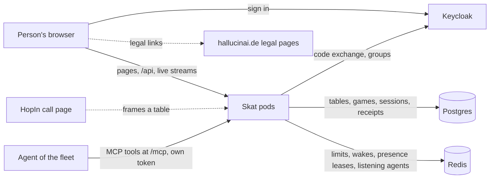
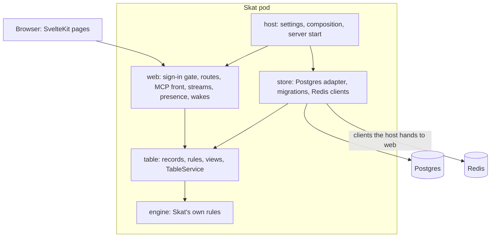
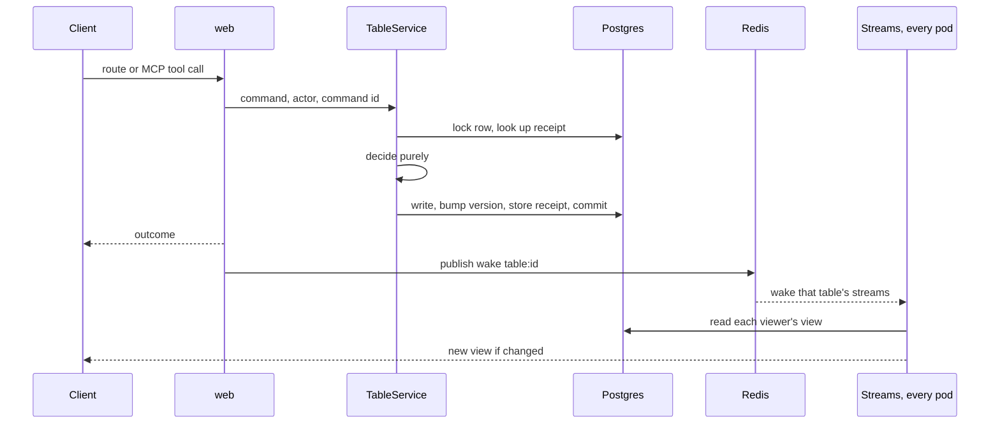

# Skat architecture

For an engineer about to change Skat; details live in module docstrings.

## 1. Context and Scope

Skat is a card table for a small circle of signed-in people and the fleet's agents, which play along through MCP tools. A table can sit on a HopIn call's stage, framed by the call's page.

Outside Skat: Keycloak signs people and agents in and says who belongs; Postgres holds everything durable; a Redis every pod shares carries what the pods must agree on but need not keep; hal composes the legal pages from Skat's part in `legal/`. Skat builds on FastAPI, Svelte and the fleet's libraries: webauth (sign-in), design (look, words), logline (logs), tandem (wakes, leases) and agents (MCP front).

*Who is outside Skat and what crosses to them; from `skat.host.app` and `skat.store.redis_clients`.*

## 2. Building Block View

Each pod is one process serving the static SvelteKit build, the JSON routes, the server-sent-event streams and the MCP front. It refuses to start without the page build, its settings, a subscription to the wakes and a database that lists its revision as served.

*The layers and their dependency direction; from the import-linter contracts in `pyproject.toml`.*

- **`skat.engine`**: Skat's own rules as pure code, from the deal to the valuation.
- **`skat.table`**: the table core. Records, the pure decision of every command, the views, and `TableService`, which runs each command as one transaction through a narrow port.
- **`skat.store`**: those ports on Postgres, the migrations and the serving window, and the Redis clients.
- **`skat.web`**: the adapter: sign-in gate, routes, MCP front, streams, presence and wakes. Every route is marked as a tool or an exclusion with its reason; an undecided route stops the build.
- **`skat.host`**: reads the settings, composes the app and starts uvicorn.
- **The frontend** (`frontend/`) builds into `src/skat/web/build` and decides no rule: it draws the server's view. Takt (`frontend/src/lib/takt/`) plays moments every seat sees alike from a seed; CSS owns where a card rests, Takt its seeded lie and travel, never a coordinate of the table.

## 3. Runtime View

*A command changing a table, the core flow; from `TableService`, `skat.web.wakes` and `skat.web.streams`.*

- **One locked transaction, then a publish.** A command locks the table's row, replays its receipt if one exists, decides purely, writes, bumps the version and stores the receipt. A move also names the version the client saw and is refused `stale-version` when that is old. Only a commit wakes streams.
- **A wake carries no data.** It names a topic, crosses pods on tandem's channel and makes a stream read again; a stream sends only a read whose digest changed. The 15-second heartbeat catches a lost wake, and a pod whose subscription returns after a break wakes every stream.
- **An agent's call is an in-process request.** The front runs the marked route with the agent's token, so every middleware, limit and check applies as for a browser. An agent is offered only the tools of its seat's moment (`moment_of`).
- **Server steps** run on timers (a chair hold running out, the next deal, an empty or long-paused table ending) and decide again under the table's row lock, so two pods or a repeat change nothing twice.

Sign-in is webauth's OIDC code flow. The issuer refuses to be framed, so a framed table signs in through a separate window (`frontend/src/lib/callSignIn.ts`).

## 4. Deployment View

Skat runs from the image the `Release` workflow pushes to `ghcr.io/overnightworks/skat`. Any number of pods share one Postgres and one Redis. `skat migrate` alone changes the schema, under an advisory lock; `skat serve` never migrates.

A rolling update runs pods of two releases on one database, so shared data stays readable for the release before:

- **Expand, then contract.** A migration only adds. A step that drops or changes what the release before reads declares `CONTRACTS = True`, is the first migration of its release and drops only what the release before no longer reads. `tests/store/test_migrations_expand.py` fails on an undeclared contraction.
- **Admit, then write.** A release writes no persisted value the release before cannot read. A new value of a closed column is admitted in one release (`one_of` lists it, `held_back` keeps it out) and written in the next; likewise a meaning an `UPDATE` rewrites, receipt payloads, wake addresses and Redis formats. `tests/store/test_schema_values_one_release.py` checks the CHECK lists against the newest release tag.
- **The serving window.** `serving_revisions` lists the revisions that may serve. `skat migrate` writes it with its steps: a run that only expands lists its starting revision beside the new head; a run whose contracting step is not its first lists the head alone. A pod starts only if its revision is listed and turns unready once it is not; `tests/host/test_main_serving_revisions.py` proves it with real processes.

Redis holds nothing durable: its restart resets the limit windows and each pod re-reads its streams. While it cannot answer, every request but `/health` gets a 503. `/health` reads only the database, because the platform's probe would otherwise restart every pod for an outage no restart cures.

## 5. Crosscutting Concepts

### Trust

- **A person's browser** controls everything it sends. Skat trusts only the session, from which the acting account always comes; a state-changing request needs same-origin provenance; requests are rate-limited per address across pods. Without a session one reaches only `/health`, the sign-in pages, the build's static files and the MCP metadata document.
- **Keycloak** decides membership: the group `/apps/skat` admits, and nothing makes anyone an admin. Skat trusts signed tokens from its one issuer and adds no rule on which clients may mint its audience.
- **An agent** is its own account, never its owner's. Its token needs the group `/agents` with an owner and a name, the group `/apps/skat/mcp` and the scope `mcp-skat`; it is valid at `/mcp` and the marked routes only, and `/mcp` refuses it with an Origin, so no browser reaches it. Only that agent reads its standing and table views.
- **Calling an agent** needs the group `/agent-adders`, read fresh from the issuer at the act; sending a seated agent away needs that group or being the owner its chair stores. The control's rows carry a derived key, never an account id.
- **A table's id** is an unguessable link, not a secret. A **rule set** is read only by the account that saved it.
- **A table's cards** reach a viewer only through the view built for that viewer's seat (`skat.table.views`), so no route or tool can leak a hidden card.
- **The call origin** (`SKAT_CALL_ORIGIN`) alone may frame Skat; framing and its messages grant it nothing, though a compromised one could trick people into clicks.
- **The proxy hops** in `SKAT_TRUSTED_PROXIES` may state the client address.
- **The shared Redis** holds client addresses, table and account ids and agents' names and owners, each only briefly. Whoever reaches it can spend or clear limits and show a false agent name or owner, but cannot seat an agent or grant a call.
- **The operator's settings and secret files** are trusted fully. Secrets come from files, never the environment; a wrong setting is named, never echoed.

### Persistence

Postgres holds every table, its running hand as append-only step logs replayed through the engine, the finished games, receipts and sessions. A finished game is never deleted, and an ended table with games stays; one without games is forgotten after `SKAT_ENDED_TABLE_DAYS`. Every command a person or an agent sends stores a receipt under (account, command id), so a retry replays its first outcome. Sessions are stored under the SHA-256 of their id, so a dump yields no usable cookie.

### Presence and Redis

Who is at a table lives in Redis, never in Postgres. Each open stream holds a tandem lease; a dead pod's people drop out when their leases lapse. An agent holds no stream: each admitted call at `/mcp` renews a lease in the process that heard it, which counts the agent present where it sits. Where presence decides something destructive, the roster is read under the table's row lock, and an unreadable roster frees and ends nothing. An away member's chair hold is a deadline in Postgres on the database's clock, swept by every pod.

### Agents at the table

A table is a member place: an agent is a member while it holds a chair there or an open invitation to it (`skat.table.member_place`). It reads `member://standing`, its tables' views and their windows of numbered acts, and is told when a commit changes one. A person calls an agent to a table or sends it away from the page; `offer_of` decides both. A seated agent states its turn with `set_turn_state`, which its chair keeps until the holder changes.

### Observability

logline owns the record: JSON lines on stdout, one per request. A timed step writes one `<noun>.ended` line with `duration_ms` and `outcome`. Skat logs ids and references, never contents; tandem's lease lines name the member. A table stores the `traceparent` of the request that moved it to its version and of each act of its latest hand, so an agent's view and window point to the request they entered in.

### Texts

`frontend/src/lib/catalogs/de.po` owns every visible text by key; further languages are catalogs beside it, translated by a model with no human gate. A varying text is one whole sentence with named gaps; no code joins texts.

### Proof strategy

Unit tests cover the logic, with a fake issuer for sign-in. Store and end-to-end tests run against a throwaway Postgres and Redis, never SQLite; the end-to-end tests drive real Chromium against a real server. Branch coverage is judged at 100 % over all layers, the frontend's merged in.

## 6. Constraints and reasons

- **The layer rule.** `host` depends on `web` and `store`, which know nothing of each other; both depend on `table`, and `engine` sits below `table`; never the other way. import-linter enforces it, and a second contract keeps `skat.table` and `skat.engine` free of every framework, driver and adapter. So the rules stay pure, testable without a process, and a new front or store never touches them.
- **A strict content security policy:** no inline script, style or handler; only the shell's bootstrap and the call sign-in page's script, admitted by hash.
- **The Python path constants own the browser's paths;** `make wire` generates the TypeScript, so a drifting path fails a check, not a page.
- **The test issuer** exists only in tests.

## 7. Not chosen

- **Skat's own sign-in:** webauth is the fleet's one implementation of sessions and admission; a need it cannot meet reopens it.
- **Another audio format for the voice than MP3:** every browser's Web Audio decodes MP3 ([MDN's audio codec guide](https://developer.mozilla.org/en-US/docs/Web/Media/Guides/Formats/Audio_codecs#mp3_mpeg-1_audio_layer_iii)); tests drive only Chromium, so Safari rests on that source.
- **Failing open while Redis is down:** it would change webauth's security default.

## 8. Risks and Technical Debt

- The expand and admit-then-write checks read the schema, not the meaning of data: review alone judges compound CHECKs, columns without a CHECK, a rewriting `UPDATE`, receipt payloads, wake addresses, Redis key and JSON formats, and the formats of tandem, agents and webauth on a bump.
- Each presence read lists every open stream's lease, as tandem has no roster per table; `lease_roster_read.ended` shows its growth.
- Agent leases, the wait clock of asks and nudges, reactions and the held answers of who may call agents live in one process: a restart forgets them, and no pod sees another's agent leases.
- A session's refresh and ID tokens are stored in plain text, because encrypting them needs a third secret on the same pod; a dump of `sessions` with the client secret mints access tokens until the session expires.
- Every agent call and sign-in entry takes one database-wide advisory lock, so they queue.
- The table record, its views and the `tables` row hold the table's state and the hand's in one type each, and the seat count is stated in the engine, the table core and the store separately.
