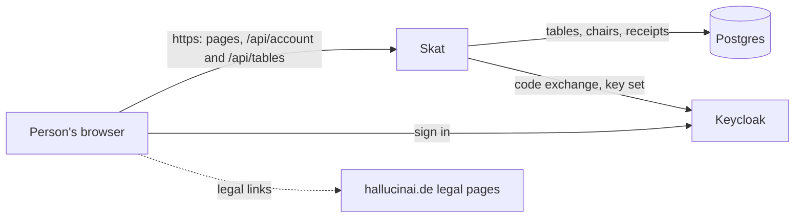
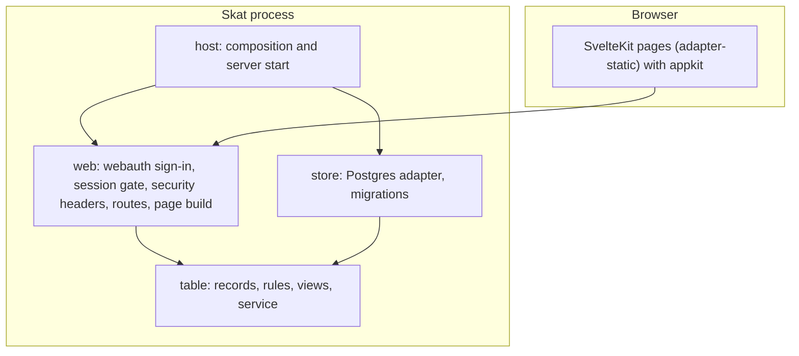
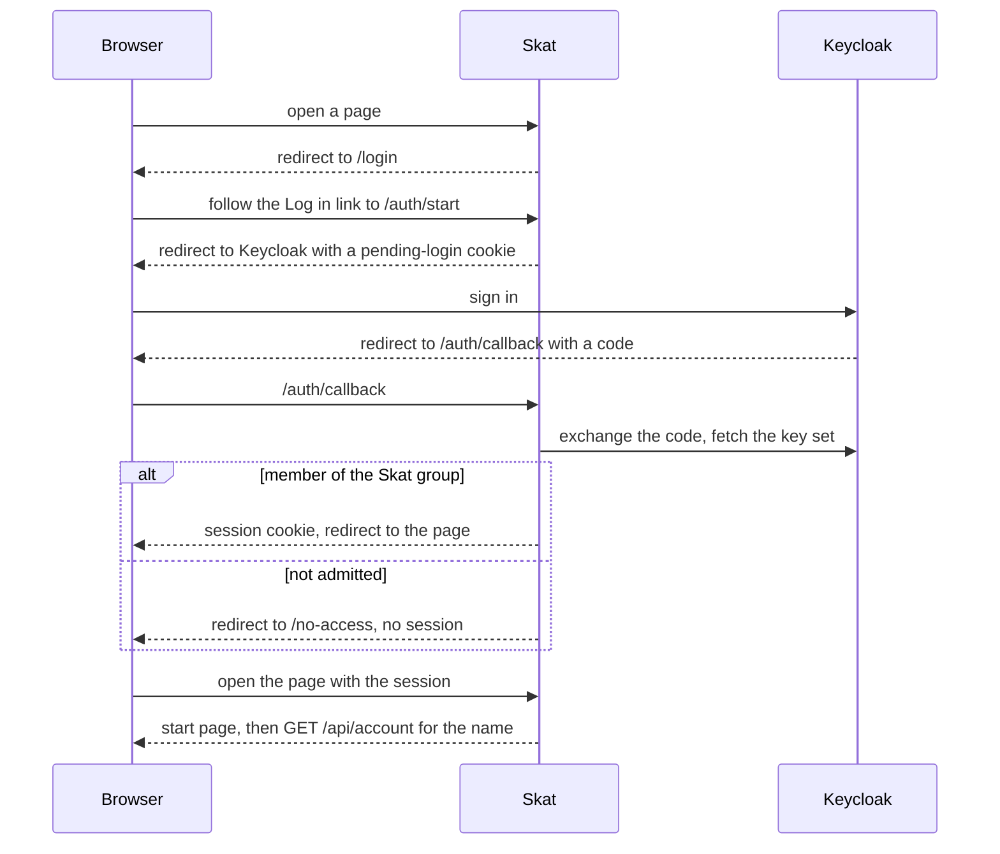

# Skat architecture

## 1. Context and Scope

Skat serves a small circle of signed-in people in a browser. Outside it: the realm's identity provider (Keycloak), which signs people in and says who belongs to the Skat group, Skat's own Postgres database, which holds tables, chairs and command receipts, and the fleet's central legal pages at hallucinai.de, which the page links and which hal composes from each app's own part; Skat's part lives in `legal/` and hal reads it from each release. Skat builds on the fleet stack, FastAPI and Svelte with webauth for sign-in and appkit for the shared look, and takes a maintained library before writing its own code. Accounts and sessions are not in the database; they stay in memory.

## 2. Building Block View

One process serves the static SvelteKit build and the few API routes. It refuses to start without the build and without a database at the newest migration.

- **`skat.host`** composes the app from settings and the page build, and starts uvicorn.
- **`skat.web`** is the adapter: webauth's sign-in routes and session gate, the security headers, the account routes, the table routes under `/api/tables`, `/health` and the page build, whose `/t/{id}` page opens a table by its link. It decides nobody's rights beyond admission.
- **`skat.table`** is the table core: records, the rules that decide a command, the views a person is allowed to see, and a service that runs each command as one transaction through a narrow port. It imports no framework, driver or adapter.
- **`skat.store`** implements that port on Postgres with SQLAlchemy and psycopg 3, and owns the Alembic migrations. `skat migrate` takes an advisory lock and upgrades the database before any other setting or the page build is read; `skat serve` never migrates and refuses a database that is not at the newest migration. Migrations only expand.
- Layer rule: `host` depends on `web` and `store`, which stand side by side and know nothing of each other, and both depend on `table`; never the other way. import-linter enforces it, and a second contract keeps `skat.table` free of SQLAlchemy, psycopg, FastAPI, Starlette and webauth.
- **The frontend** (`frontend/`) is built to `src/skat/web/build`. The path constants it needs are generated from the Python constants.

## 3. Runtime View

Opening a table is one transaction: the service looks up the receipt under (account, command id), decides with a random 128-bit table id, writes the table with its opener in chair 1, its version and the receipt, and commits. The same command id with the same request returns the first table; another request under it is refused; two identical requests at once end with one table, because the receipt's key is unique and the loser's transaction rolls back and replays the winner's.

Signing out is a POST to `/logout`: Skat ends the session and clears its cookies, and the person's browser posts the ID token hint to Keycloak's end-session endpoint, which returns to `/login`.

## 4. Deployment View

Skat is not deployed. CI builds the image from `Dockerfile` without pushing it; the `Release` workflow pushes it to `ghcr.io/overnightworks/skat`.

## 5. Crosscutting Concepts

### Trust

The model is Skat's own.

- **A person's browser** controls everything it sends. Skat trusts only the session: the name shown comes from the Keycloak account, and a state-changing request needs same-origin provenance. HTTP requests are rate-limited per address, and the sign-in routes have their own budget; `/health` is exempt.
- **Anyone without a session** reaches only `/health`, the sign-in pages, the sign-in routes, the stylesheets and fonts those pages link, and Keycloak's logout POST. A forged, altered or expired session cookie counts as no session.
- **Keycloak** decides who is a member: the group `/apps/skat` admits, and no group makes anyone an admin. Skat trusts its signed tokens from the one configured issuer. The session store holds each login's ID token, a secret that leaves the server once, in the no-store logout page whose form the browser posts to Keycloak.
- **The proxy hops** named in `SKAT_TRUSTED_PROXIES` are trusted to state the person's address in `X-Forwarded-For`; empty trusts none.
- **A table's id** is an unguessable link, not a secret: every signed-in member who has it sees the table. A client names only its retry key; the account and the chair always come from the session.
- **The operator's settings and secret files** are trusted fully. The two secrets and the database URL come from files and never enter the environment, and a wrong setting is named, never echoed.

### Proof strategy

Unit tests cover the logic and webauth's wiring through a test client with a fake issuer; the store's tests and the end-to-end tests run against a throwaway Postgres of the same major version as CI's service, migrated by Alembic, never SQLite. End-to-end tests drive real Chromium against a real server for sign-in, refusal, the start page, opening a table and sign-out. Branch coverage is judged at 100 % over both together, merged with the frontend's.

## 6. Constraints and reasons

- Skat's markup holds no inline script, `<style>`, `style=` or `on*=` attribute: the page runs under webauth's content security policy, which admits only the SvelteKit bootstrap script and the route announcer's style by hash.
- The sign-in pages are prerendered with `csr = false`, so they carry no script.
- The Python path constants own the browser's paths, and `make wire` generates the TypeScript, so a drifting path fails `make wire-check` instead of showing at runtime.
- The test issuer exists only in tests and is never wired into the production composition.

## 7. Not chosen

- Skat's own sign-in: webauth is the fleet's one implementation of the session and admission rules; a need it cannot meet reopens it.

## 8. Risks and Technical Debt

- Accounts and sessions live in memory: a restart signs everyone out, and a second instance would not share them.
