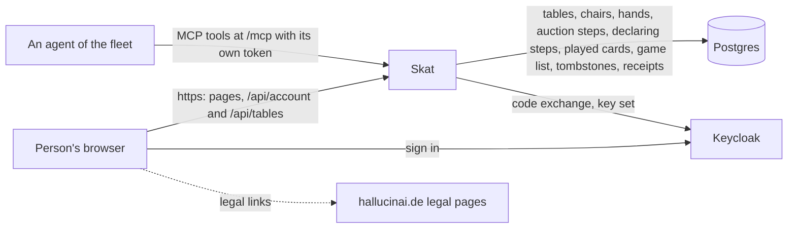
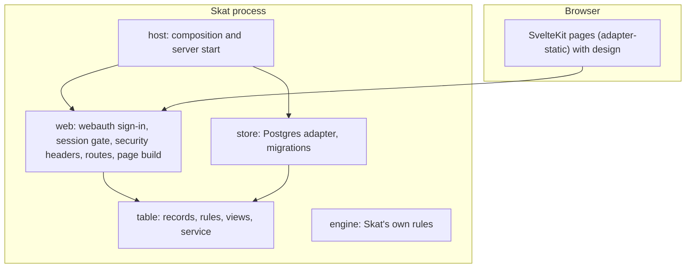
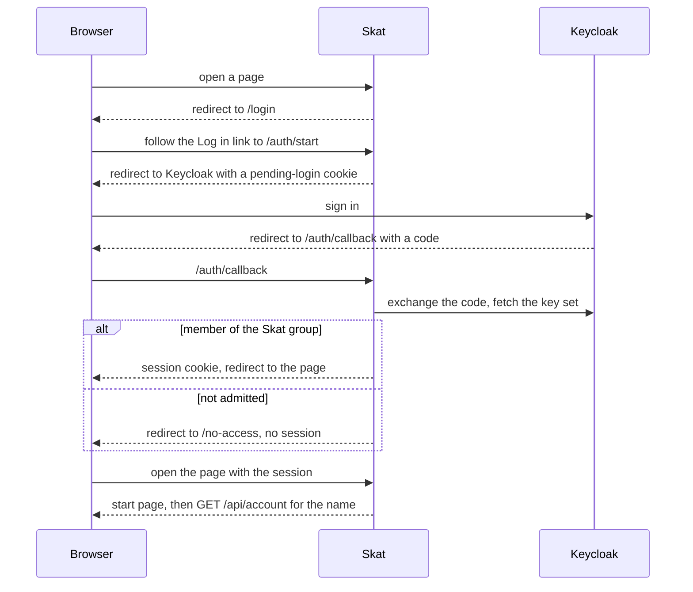

# Skat architecture

## 1. Context and Scope

Skat serves a small circle of signed-in people in a browser. Outside it: the agents of the fleet, which play at Skat's `/mcp` under a token of their own (see Trust); the realm's identity provider (Keycloak), which signs people in, says who belongs to the Skat group and signs the agents' tokens, Skat's own Postgres database, which holds tables, chairs, dealt cards, auction steps, the declarer's steps, the cards played, the table's list of played games, a tombstone row for a table that ended, the rule sets people saved, and command receipts, and the fleet's central legal pages at hallucinai.de, which the page links and which hal composes from each app's own part; Skat's part lives in `legal/` and hal reads it from each release. Skat builds on the fleet stack, FastAPI and Svelte with webauth for sign-in and design for the shared look, and takes a maintained library before writing its own code. Accounts and sessions are not in the database; they stay in memory.

## 2. Building Block View

One process serves the static SvelteKit build and the few API routes. It refuses to start without the build and without a database at the newest migration.

- **`skat.host`** composes the app from settings and the page build, and starts uvicorn.
- **`skat.web`** is the adapter: webauth's sign-in routes and session gate, the security headers, the account routes, the call origin route (`/api/call-origin`), the table routes under `/api/tables`, the rule-set routes under `/api/rule-sets` (saving and reading are tools, deleting one is none), `/health` and the page build, whose `/t/{id}` page opens a table by its link. It decides nobody's rights beyond admission. `web/mcp.py` owns the MCP front: it builds the protected resource and the front from the agents library. Every route carries the mark of a tool or an exclusion with its reason, and an undecided route stops the build.
- **`skat.table`** is the table core: records, the rules that decide a command (a stand-up is refused while a hand runs), the views a person is allowed to see, and a service that runs each command as one transaction through a narrow port. A person's saved rule sets (`table/rule_sets.py`) are no table: their own small service and port save, list and delete the sets of the account that acts. Each phase of a hand and each house rule with a table step is one module per layer (`table/auction.py`, `store/auction.py`, `web/auction.py`; `table/kontra.py`, `store/kontra.py`, `web/kontra.py`) with one short method on the command runner, and `HandProgress` holds what the phases recorded. Refusals have one owner per token: `Refusal` holds the table's own reasons and the engine's enums hold theirs, and one parser reads a stored token back. It imports no framework, driver or adapter.
- **`skat.engine`** holds Skat's own rules as pure code below the table. The table calls its deck, its deal and its bidding: the third sit draws the first dealer and deals the hand, a seated player's bid runs through the engine's auction, the declarer's steps through its declaration, every card through its tricks, every word of Kontra through `kontra.py`, which replays a hand's stored words against the cards each followed and prices the doubled list score, a declarer's give-up, at once or with an opponent's yes, and either side's throw-down through its giving-up rules, and the trick that ends the game, the tenth or the one that decides a Null or Schwarz-announced game, through its valuation and settlement. It imports no framework, driver or adapter.
- **`skat.store`** implements those ports on Postgres with SQLAlchemy and psycopg 3, and owns the Alembic migrations. `skat migrate` takes an advisory lock and upgrades the database before any other setting or the page build is read; `skat serve` never migrates and refuses a database that is not at the newest migration. Migrations only expand. The option columns of a table (`show_running_points` and the three Kontra columns, with their checks) have one owner, `option_columns` in `store/schema.py`, which `tables` and `rule_sets` both use, and `options_of` and `option_values` are the one mapping between those columns and `TableOptions`; `rule_sets` holds per set its id, its owner's account id, its name (unique per owner) and the option columns. A table keeps its dealer in a column and its dealt hand in a card table with one row per card, whose key holds each card once per table and whose `holder` column names the position or the skat; the third sit stores both with its chair and receipt. The auction is `auction_actions`, one row per accepted step and ordinal, and the table reads it back by replaying the steps through the engine; a save whose stored steps are no prefix of the new ones raises, so an earlier step cannot be rewritten, and a stored log the engine refuses raises at the next command. The declarer's steps are `declaring_steps`, the same pattern with one row for a take, a put-back or a declaration; taking the skat changes no `hand_cards` row, and `save_table` raises when the hand it is given differs from the one dealt while the hand has progress, so the deal stays as dealt. The words of Kontra and Re are `kontra_words`, one row per word with its position and how many cards were played before it, deleted with the hand like the cards; the table replays them per hand, so a word is judged against the cards it followed and never against another hand's. The cards played are `played_cards`, one row per card and ordinal, with a unique key that holds each card once per table; the trick is derived from the ordinal and never stored, and the table replays the rows through the engine as well. The third pass, the card that ends the game, the declarer's give-up, an opponent's yes to it and a side's throw-down are the five changes of the stored hand that do not raise while the hand has progress. The third pass ends the hand: its cards are deleted in that transaction, and its steps stay until the next deal replaces them, because the view between hands reads the passed-in fact from them. A hand passed in has no declarer, so it has no declaring steps. The card that ends the game, the thirtieth or the one completing the deciding trick, the declarer's give-up, an opponent's yes to it or a side's throw-down, ends a played hand: the record it leaves has no hand and empty progress, and its game joins the table's list, `TableRecord.game_list`, which outlives every deal of its series and goes with the next series' first deal or with the table. `save_table` tells this end apart from a passed-in one by the longer list, and in that transaction one named step deletes the table's rows in `hand_cards`, `auction_actions`, `declaring_steps`, `played_cards` and `kontra_words` before `game_list` gains the new row. `game_list` is keyed by table and ordinal and holds the three seated accounts by seat and their display names with every number of the entry (its score already doubled by the words, and the last word said): the game's value and settlement from the engine, the bid from the auction and the declarer's points from the played tricks; a save whose list does not continue the stored one raises, as the step logs do, except at a series' first deal, which deletes the stored rows first. A give-up the declarer asked for below nine cards is stored in `tables.give_up_asked_by` and `tables.give_up_declined_by`, the asking position and the opponent who said no, written from the record with every save, so a card, an ended hand and a deal clear them without a delete of their own. Every deal goes through one owner, `dealt` in the rules, which empties the hand's progress. A table that ends keeps its `tables` row as a tombstone (`ended_at`, `end_reason`, `empty_seconds`, the dealer cleared and the version bumped once), whose key keeps the id from being issued twice; `end_table` is the one step that deletes the table's rows in `chairs`, `hand_cards`, `auction_actions`, `declaring_steps`, `played_cards`, `kontra_words`, `game_list` and every receipt of it but the create receipt, so a create retry still finds its table. A tombstone reads as `EndedTable`, and a command that locks a table finds none there.
- Layer rule: `host` depends on `web` and `store`, which stand side by side and know nothing of each other, and both depend on `table`, and `engine` sits below `table`; never the other way. import-linter enforces it, and a second contract keeps `skat.table` and `skat.engine` free of SQLAlchemy, psycopg, FastAPI, Starlette, webauth, the agents library and the MCP SDK.
- **The frontend** (`frontend/`) is built to `src/skat/web/build`. The path constants it needs are generated from the Python constants.

## 3. Runtime View

### A framed table signs in through a separate window

The call's frame cannot take the person to the issuer, which refuses to be framed, and its sandbox lets no framed page submit a form. A signed-out visit to `/t/{id}` with `mode=call` (`CALL_MODE`) therefore leaves the gate for `/login`, which answers 303 to `/login/call` with the same `next`; every other return address gets the plain sign-in page. The call sign-in page reads `next` from its own address and keeps only an id that matches `TABLE_ID_PATTERN` under `TABLE_PAGE_PREFIX`; anything else leaves the plain `/auth/start` link and opens no window. The face's legal links open in a new tab, because the legal origin refuses to be framed, and start no account check; its "Log in" before the page's script has run reloads the face.

"Log in" opens `/auth/start` in a separate window that returns to the plain table, and the frame shows that sign-in runs there, with a plain link that opens the table in a tab of its own. Every 500 ms the frame reads the window's address, which throws while the window shows another origin. The window ending at the table closes and the frame reloads into the call-mode table; ending at `/no-access` closes it and the frame shows No access, without a log-out action, because a log-out would end the person's session in the call too. A window closed first leaves the frame to ask `/api/account`: a 200 brings the table, anything else shows the sign-in face with a notice and asks again every 2 s for 3 minutes, which also covers a sign-in finished in the plain link's tab. The sign-in face sends and reads no message to the call, and `window.open` returning null leaves the plain link as the way on. `frontend/src/lib/callSignIn.ts` owns these decisions.

A framed call-mode table page (`isFramedInCallMode`) shows its wordmark as text and offers neither „Link kopieren“ nor „Neuer Tisch“, so no tap leaves the call mode and the call, which already shares the table, opens no public one.

### A framed table greets the call and drops its own bar

The framed call-mode table asks the signed-in route `/api/call-origin` for the configured call origin (null when unset), posts one `ready` (`v`, `type`, and the table id of its own address) to exactly that origin, never `*`, and takes the first valid `hello` after it. That `hello` drops the page's own bar and removes the page's message listener, so no later message is read, and the stage then takes no tap for one second because the table moves up; a call that never greets leaves the bar. A message counts only when it comes from the parent window, from the call origin byte for byte, as a plain object with exactly the keys `v`, `type`, `attachment` and `attempt`, version 1, a positive safe integer attachment and a null attempt; the exact key set is the size bound, and an ignored message leaves no trace. A route that fails or answers anything but 200 counts as no origin, and no `ready` goes out. A greeting changes only the page's own surroundings: nothing in it reaches the DOM, a request or storage, and the page's commands keep their own session and checks. A reload is a new document and greets again; a top-level page, a framed page without the call mode and the sign-in face post nothing. `frontend/src/lib/callFrame.ts` owns these decisions.

An agent's tool call is one in-process request into the whole app. The agent presents its bearer token at `/mcp`; webauth's bearer gate admits it before routing, creates its own account (kind agent) on its first token, and the front answers `tools/list` and `tools/call` at revision 2026-07-28 alone. A call runs the marked route with the same token, so every middleware, the rate limit and the route's own checks apply as for a browser, and the route reads its actor from the admitted account. A refusal of the route comes back as a failed tool result with its reason.

Opening a table is one transaction: the service looks up the receipt under (account, command id), decides with a random 128-bit table id, writes the table with its opener in chair 1, its version and the receipt, and commits. The same command id with the same request returns the first table; another request under it is refused; two identical requests at once end with one table, because the receipt's key is unique and the loser's transaction rolls back and replays the winner's.

### The live view of a table

An open table page holds one server-sent-events stream (`GET /api/tables/{id}/events`, Starlette's streaming response). Admission is the session gate's at open, and an id that is no table is a plain 404 before anything is held open. A stream registers itself in `skat.web`'s in-memory presence registry, then reads and sends the full view built for its own account with `view_of`, then sends a fresh view after each change; no message names an account id or a watcher. The page shows the first view of a table it read once, then lets each message replace it. A page that reads or receives the ended view shows why the table closed, with the stored wait, and keeps no stream open: `watchTable` closes its source on that message, and a first read that already answers `ended` opens none.

- **Presence is process-local.** The registry keys connections per table and account, so an account in two tabs is one watcher; the count is the connected accounts without a chair. It lives only in this process, which is the one replica Skat runs as, and is never stored.
- **An agent's lease is its presence.** An agent holds no stream, so every admitted call at `/mcp` renews a lease of `LEASE_SECONDS` (the fleet's value, from the agents library) for its account, and a lease counts the agent as connected at the tables where it sits: `TableService` takes who is present at a table from the pure rule `present_at`, the open streams plus the live leases of that table's occupants, so a lease never keeps another chair, its owner's included, alive. One timer per lease re-arms itself to the lease's end. When a lease starts, its tables' streams are woken and their next deal is asked for; when it lapses, the agent is away as a person is: the streams are woken, a chair hold starts and a table with no stream open waits afresh for its end, and a pending hold frees nothing while a lease runs. Both read the agent's tables once and retry together after a failure. An agent has no move deadline: a hold frees nothing during a hand. Only calls at `/mcp` renew, and only an agent's; a call made straight at a marked route does not. Leases are not stored: after a restart every chair has its full hold, and an agent's next call starts its lease. A non-seated agent counts as nothing.
- **An away member's chair is freed by a timer per leave.** When an account's last stream on a table ends, presence records the leave on a monotonic clock and asks the event loop for one check after `SKAT_CHAIR_HOLD_SECONDS`; a returning stream clears the record. The check frees the chair only while that leave is still the account's latest, through `TableService.free_chair`, which runs off the event loop and wakes the table's streams after its commit. A failed freeing wakes nothing, is logged by error type and is checked again after a fixed delay until it commits. Leave times are not stored: at start, every occupied chair counts as just left, so a restart never frees a chair early and delays the freeing by at most one hold plus the outage. Shutdown cancels every pending check. The freeing's worker checks, once it holds the table's row, that the leave is still the latest and the server still runs, and a reconnect before that check keeps the chair; one after it awaits the commit on the event loop, never blocking it, and finds the chair freed. Shutdown starts no further freeing and waits, without blocking the event loop, for a write whose check already passed to end its transaction. A sweep would need a tick and free late, so the hold uses none.
- **The server frees a chair as a command with no actor.** `free_chair` locks the table's row, asks the same pure decision as standing up (the chair is freed only while the account still holds it and no hand runs), writes the chair and bumps the version in one transaction. It authorises nothing and writes no receipt: it carries no command id, and a repeat finds the chair already free and changes nothing. It and the next deal are the commands with no receipt. A member away when a hand ends gets a fresh hold: the ending command gives those not present (no stream, no live lease) a newer leave time before it commits, so a freeing that was already waiting for the row finds itself superseded, and the service returns who sat at the table and who was not present, because a view carries no account id, so that after the commit the route hands those the command found not present to the same hold; a retry of the ending command restarts none.
- **A table on which no hand was dealt ends by a timer per table.** Presence, which does not know whether a hand was dealt, starts one wait of `SKAT_EMPTY_TABLE_SECONDS` for a table when it is created, when its last stream ends and, for every undealt live table, when the server starts, with what is left of it; a stream that opens ends the wait, so the pending timer finds itself superseded. When the timer fires and is still the table's latest, `TableService.end_empty_table` takes the table's row lock, reads who is connected there, and ends the table through `end_table` only while its dealer column is empty (no hand was dealt) and nobody is connected; a dealt table pauses and keeps all its rows. The check runs on the same context as the next deal: the context yields nothing to decide on once the server has stopped or a stream has opened since the wait began, which ends nothing; the end stays awaited by shutdown until its commit, and writes no receipt and no actor. A failed end is logged by error type and table id and checked again after the hold's retry delay while the wait stays the latest. The wait is stored with the end, so the ended table's answer (`ended` with the reason and the whole seconds) stays true after the setting changes; the answer, a stream and a create retry under the ended table's command id all carry it, and a stream sends it as its last message. The time since when nobody has been at the table is stored in `tables.empty_since`, apart from the table record, so a command can never overwrite it: `TableService.create` writes it when the table is created, and `TableService.note_presence` writes it on the locked row, with presence read there, when its last stream ends or an agent's lease lapses (stamped unless an earlier time stands) and when a first stream opens or a lease starts (cleared, before that stream shows anything); it bumps no version and writes no receipt, and the sit that deals the table's first hand clears the time in its own transaction, so a dealt table holds none; a store failure fails an opening stream with no message or is retried after the hold's retry delay. A stream that opens after the time was up ends an undealt table instead of reviving it. At start, `TableService.resume_empty_waits` stamps every undealt live table with no time to now, ends every undealt table already past its wait before the server serves, and seeds each other undealt table's timer with what is left of its wait, so a restart never gives a table a fresh wait it had begun, and a table someone was at when Skat stopped gets a full wait from the start. The end deletes the table's rows but keeps its own row as a tombstone.
- **The next hand comes by itself after a passed-in hand.** When a command ends a hand, presence starts a table's pause from then, on the same timers as the chair hold; a pause still pending from an earlier hand is replaced and its timer does nothing when it fires, so a pending timer cannot shorten this one's. When a stream's first view finds a table passed in, presence starts a pause only if none is pending, so a stream opening during the pause neither cuts it short nor stretches it. When the pause ends, `TableService.deal_next` takes the table's row lock and deals only if the pure decision in `skat.table` holds on the locked row: no hand runs, the table has a dealer, all three chairs are occupied and all three occupants are connected at that moment, and while a played game's result is pending, or at a series' end, all three chairs are ready. Its worker reads who is connected once it holds the row, reads nothing to decide on once the server has stopped, and stays awaited by shutdown until its commit, so no deal is written after the stop. It draws through the one place a hand is drawn, bumps the version once and writes no receipt, and the streams wake after its commit; a repeat, or a table that changed meanwhile, changes nothing. A member who is away keeps their running hold, and their return, a stream opening or an agent's call starting its lease, starts a fresh pause. A failed deal is logged by error type and changes nothing; the next stream opening asks again. No pause is stored: after a restart none is pending, and all three connected can only become true through streams opening or an agent's call starting its lease, so no sweep is needed. A handler that dies between the last pass's commit and its scheduling heals when a stream opens or an agent's lease starts.
- **The paused list is read per account from the chairs.** `GET /api/paused-tables` and the tool `read_paused_tables` ask `TableService.paused_tables`, which scans the occupied chairs once for the caller's tables, then reads each record under its shared row lock and lists it only while a hand was dealt on it and the caller still holds a chair there; an ended table is skipped. The entry projects the table's view for the caller (chairs with names and totals, game number and length, the seat on turn or a waiting result) and carries no card, account id or watcher. It stores no fact of its own and does not look at who is connected.
- **After a played game, the next hand comes once all three have tapped „Weiter“.** Each chair stores its occupant's mark (`chairs.ready`, which a check keeps off a free chair). `POST /api/tables/{id}/ready`, which an agent calls as the tool `continue_after_result`, names the result the page saw by its number in the list and marks the actor's chair; a tap for another result is refused as `stale-result`, one with no result pending as `no-result`, and one from a chair already ready changes nothing and bumps no version, so a second tab's tap is no error. At a series' end `POST /api/tables/{id}/new-series` (an agent calls it as the tool `start_new_series`; the third tap deletes the list for good) sets the same mark, refused as `not-seated`, `no-series` or `series-not-over`. Whoever sits while a result is pending counts as ready, so that sit no longer deals at once; standing up, or a freed hold, takes only that chair's mark, and the one deal step clears every mark. After every accepted or replayed tap, after a sit during a pending result and on a stream's first view of a pending result, presence asks `deal_next` at once, with no pause, and the guard on the locked row decides: two taps that complete the marks serialise on the row lock, so the later deal finds a hand and does nothing; a member who is away delays the deal until their stream opens or, for an agent, its next call; a deal lost after its tap's commit follows the retry. Nothing of this lives in memory, so after a restart a pending result deals when the streams reopen, which every page does on load.
- **A table may run a series, and the one deal step counts it.** The opener names the length in the request that opens the table: any multiple of 3 from 3 to 99, checked in the request and by a check constraint, fixed for the table's life. `tables.series_length` and `tables.series_deals` hold it, both null for a table without a series, which plays on without a count. Every deal but a next series' first adds one to `series_deals` in `dealt`, the step every sit, tap and timer deal goes through, so a passed-in hand counts although it leaves no list row; the answer's `series` says which game of how many runs and whether the series is over. After the last game no sit deals and the next deal waits for all three „Neue Serie“ marks and all three connected; that deal empties the list and starts the count again at one, „Weiter“ is refused as `series-over`, a sitter at the end is not marked ready, and a passed-in last game names no next dealer. The last game's result stands. Once the series is over, the answer's `series.standings` ranks every account the list ever seated by total, then more games won, then fewer lost as declarer; a full tie shares the place and the next place counts everyone above it (1, 1, 3). Each list row keeps the three seated names, so a departed person is still ranked by name.
- **A table's rule options are one record, fixed when the table opens.** The opener may send `options` in the create request (a strict, closed object; without it the table plays the official rules). `tables.show_running_points` holds the first option and `tables.kontra_sayer`, `kontra_reach` and `kontra_deadline` the second, all three set or all three null, written once by `add_table` and never rewritten, and every live table's answer carries it as `options`; an ended table keeps none. With it on, `playing.running_points` gives everyone the card points each side holds in completed tricks (`Playing.tally`, which leaves out the skat); a Null game shows none. `options.kontra` makes the table play the words: who may say Kontra, how far the words go and until when (a player's own next card), all three named or none. An opponent says Kontra, the declarer Re, and up to Hirsch the Kontra opponent Supra and the declarer Hirsch; play never waits for a word. Each word doubles the game's list score once more, which the entry stores, and the standings option doubles the 50 and the 40 too, read from the table's options when a total is counted. A person may save the options under a name as a rule set; a set belongs to the account that saved it and copies nothing into a table until the client sends its options in the create request, so a table keeps its options when the set changes or goes and its answer names no set. The create receipt's payload gains `"show_running_points":true` and the `"kontra"` object only when they are on, so a receipt stored earlier still replays and a retry with other options is refused as a reused command id.
- **A command that changes a table is one locked transaction, then a publish.** A sit, a stand, an auction step, a declaring step, a played card, a word of Kontra, a give-up, an opponent's yes or no to it, a throw-down, „Weiter“ or „Neue Serie“ locks the table's row with `SELECT … FOR UPDATE`, looks up its receipt under (account, command id), decides purely in `skat.table`, writes the change, bumps the version and stores the receipt, then commits. A read takes the same row's shared lock (`FOR SHARE`) instead, so a writer cannot commit between its statements and it sees one moment of the table. Two sits at one table therefore run one after the other: the loser's decision sees the chair taken and is refused with the holder's name, and a retry returns the stored outcome. An auction step, a declaring step, a played card, a word of Kontra, a give-up, an opponent's yes or no to it or a throw-down also carries the version the client saw: a fresh command with an older one is refused as `stale-version`, while a retry is recognised by its receipt before that check. A replay reads its receipt's table under the shared lock too, except inside a command that already holds its own table's row and would otherwise risk a lock cycle with a command at the receipt's table. Only after the commit does the web layer wake the table's streams; a refused command wakes none.
- **A lost wake is recovered on the heartbeat.** A stream remembers the version it last sent. On each idle heartbeat it reads the view again and sends it only when the version has moved, so a committed change whose wake was lost reaches every stream within one heartbeat.
- **A wake carries no data.** An account appearing or disappearing at a table wakes the others with the version unchanged, and a lost wake of that kind is not recovered on the heartbeat, which sends only when the version moved. A wake is only a signal, so a stream that falls behind finds its wakes folded into one and reads the latest state, which is its fresh snapshot. A slow client never queues anything or delays another stream.
- **A stream re-admits its session.** Before each view it sends and on every idle heartbeat (`STREAM_HEARTBEAT_SECONDS`, the tick that also re-checks the version), it calls webauth's `admit_session` off the event loop, which also renews the session. A refusal ends the stream with nothing more sent; a store error ends it loudly. An ended session therefore stops receiving the table within one heartbeat.
- **A refused page signs in again.** When a stream ends, the page asks the table's session check. On a 401 it navigates to `/auth/start` with the table as `next` and a marker query, and returns to the table without a click while the issuer's own session lives. A framed page in call mode reloads instead: the gate leads the frame to the call sign-in page, and one tap signs in again there. A refusal within a bounded window of loading a page that carries the marker reloads the table address, which the gate answers with the sign-in page, instead of navigating again. The marker is in the address, so the page keeps nothing on the device, and it removes the marker from the address once its first table request has been made. Checks run one at a time. Any other answer is a lost connection.
- **Shutdown ends the streams first.** uvicorn runs the lifespan shutdown only after it has waited for connections to close, so `StreamsEndingServer` (`skat.host.main`) stops the presence registry as shutdown begins: every open stream ends, and the wait finishes without cancelling anything or logging an error.
- **A lost connection** dims the page's last view and shows "verbinde neu" while the browser reconnects by itself; the first message of the new stream is a full view that replaces it. An ended view closes the stream for good, so a closed table never shows it.

Signing out is a POST to `/logout`: Skat ends the session and clears its cookies, and the person's browser posts the ID token hint to Keycloak's end-session endpoint, which returns to `/login`.

## 4. Deployment View

Skat runs live from the image the `Release` workflow pushes to `ghcr.io/overnightworks/skat`; CI builds the image from `Dockerfile` without pushing it.

## 5. Crosscutting Concepts

### Trust

The model is Skat's own.

- **A person's browser** controls everything it sends. Skat trusts only the session: the name shown comes from the Keycloak account, and a state-changing request needs same-origin provenance. HTTP requests are rate-limited per address, and the sign-in routes have their own budget; `/health` is exempt.
- **Anyone without a session** reaches only `/health`, the sign-in pages (among them the call sign-in page, the one public page that runs a script), the sign-in routes, the build's immutable files under `/_app/immutable/` (compiled code, stylesheets and fonts of the public repository, no data), the build's version file `/_app/version.json` (only the build's id), Keycloak's logout POST, and the public metadata document of `/mcp` at `/.well-known/oauth-protected-resource/mcp`. A forged, altered or expired session cookie counts as no session.
- **Keycloak** decides who is a member: the group `/apps/skat` admits, and no group makes anyone an admin. Skat trusts its signed tokens from the one configured issuer. The session store holds each login's ID token, a secret that leaves the server once, in the no-store logout page whose form the browser posts to Keycloak.
- **An agent** holds a token of its own that the realm signs for Skat's audience. webauth admits it only when the token carries the group `/agents` with an owner and a name, the group `/apps/skat/mcp` and the scope `mcp-skat`, and then the agent is its own account, never its owner's. The token is valid at `/mcp` and directly at the marked routes only; on every other route it is refused. At a marked route an admitted bearer skips the CSRF check and may carry an Origin; only `/mcp` refuses a token sent with an Origin, so no browser reaches it. A tool call replays the token, so the actor stays the agent and a client names no chair, seat or account. Only an agent's token admitted at `/mcp` renews its own lease, so a lease keeps alive no chair but the agent's own. The realm alone decides which clients may mint Skat's audience; Skat adds no admission rule of its own.
- **The proxy hops** named in `SKAT_TRUSTED_PROXIES` are trusted to state the person's address in `X-Forwarded-For`; empty trusts none.
- **The call origin** named in `SKAT_CALL_ORIGIN` may frame every Skat page (`frame-ancestors`); no other origin may, and unset allows none. Framing grants it nothing in Skat: the framed page keeps its own session and checks, and a request the call page sends is refused like any cross-origin one. The framed table posts only to that origin and accepts a message only from its parent window, of the checked shape and version; a message grants nothing. The remaining risk is that a compromised call origin could trick people into clicks on a framed Skat page.
- **A rule set** is read only by the account that saved it: its id is 128 random bits, every route takes the owner from the session, and an id that is unknown, someone else's or malformed answers 404 alike. An agent's sets are its own account's, never its owner's.
- **A table's id** is an unguessable link, not a secret: every signed-in member who has it sees the table. A client names only its retry key; the account and the chair always come from the session.
- **A table's cards** reach a viewer only through the view built for them: their own cards and the other chairs' counts, which are the cards still held while a game is played. A played card is public: it shows in the trick in progress and in the last completed trick. The declarer alone sees the skat, on picking it up and until two cards are put back; a Hand declarer never does; and an ouvert game's open cards, likewise the cards still held, are open to every viewer.
- **The operator's settings and secret files** are trusted fully. The two secrets and the database password come from files and never enter the environment; the database URL carries no password and comes from the environment, and a wrong setting is named, never echoed.

### Texts

`frontend/src/lib/catalogs/de.po` owns every visible Skat text. `scripts/generate_words.py` writes the typed `frontend/src/lib/words.ts` from it (`make words`; `make words-check`, part of `make lint`, fails on drift). A missing, empty or fuzzy translation fails the generator and a missing key fails the type check, so nothing fails at runtime. The sign-in pages keep design's English. A further language is one more catalog checked against `de.po`'s keys; choosing it is a later item.

### Proof strategy

Unit tests cover the logic and webauth's wiring through a test client with a fake issuer; the store's tests and the end-to-end tests run against a throwaway Postgres of the same major version as CI's service, migrated by Alembic, never SQLite. End-to-end tests drive real Chromium against a real server for sign-in, refusal, the start page, opening a table, watching it live, sign-out, framing (the configured call origin shows a table, every other origin is refused), greeting the call from a frame, signing in from a frame through the separate window and signing in again there after a session ended. Branch coverage is judged at 100 % over both together, merged with the frontend's.

## 6. Constraints and reasons

- Skat's markup holds no inline script, `<style>`, `style=` or `on*=` attribute: the page runs under webauth's content security policy, which admits only the SvelteKit bootstrap scripts of the shell and of the call sign-in page, and the route announcer's style, by hash.
- The plain sign-in pages are prerendered with `csr = false`, so they carry no script, and the page build refuses to start when one does; the call sign-in page alone runs a script, admitted by hash.
- The Python path constants own the browser's paths, and `make wire` generates the TypeScript, so a drifting path fails `make wire-check` instead of showing at runtime.
- The test issuer exists only in tests and is never wired into the production composition.

## 7. Not chosen

- Skat's own sign-in: webauth is the fleet's one implementation of the session and admission rules; a need it cannot meet reopens it.

## 8. Risks and Technical Debt

- Accounts and sessions live in memory: a restart signs everyone out, and a second instance would not share them. An open table page comes back through the issuer by itself, a framed one after one tap ("A refused page signs in again").
