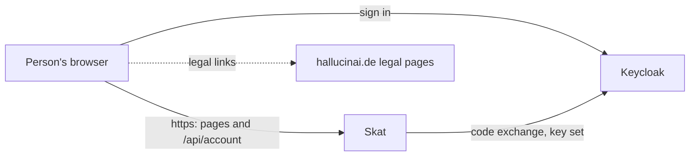
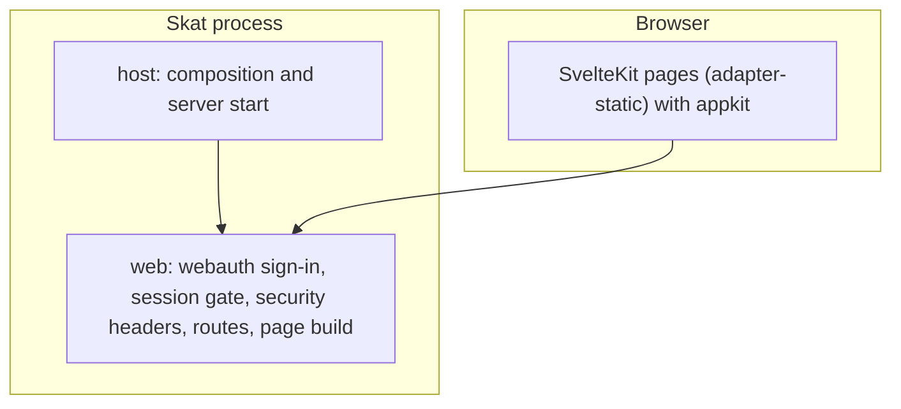
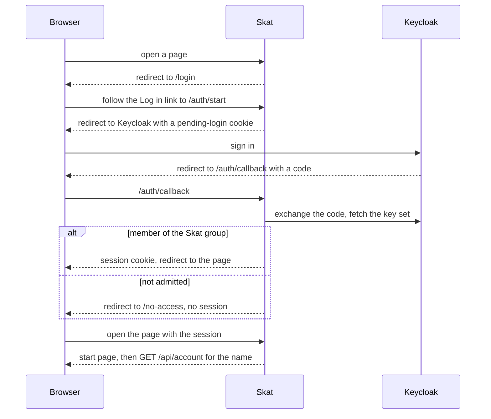

# Skat architecture

## 1. Context and Scope

Skat serves a small circle of signed-in people in a browser. Outside it: the realm's identity provider (Keycloak), which signs people in and says who belongs to the Skat group, and the fleet's central legal pages at hallucinai.de, which the page links and which hal composes from each app's own part; Skat's part lives in `legal/` and hal reads it from each release. Skat builds on the fleet stack, FastAPI and Svelte with webauth for sign-in and appkit for the shared look, and takes a maintained library before writing its own code. Today it holds no tables and no data of its own.

## 2. Building Block View

One process serves the static SvelteKit build and the few API routes. It refuses to start without the build.

- **`skat.host`** composes the app from settings and the page build, and starts uvicorn.
- **`skat.web`** is the adapter: webauth's sign-in routes and session gate, the security headers, the account routes, `/health` and the page build. It decides nobody's rights beyond admission.
- Layer rule: `host` depends on `web` and never the other way; import-linter enforces it. Domain and application packages join below `web` with their first caller.
- **The frontend** (`frontend/`) is built to `src/skat/web/build`. The path constants it needs are generated from the Python constants.

## 3. Runtime View

Signing out is a POST to `/logout`: Skat ends the session and clears its cookies, and the person's browser posts the ID token hint to Keycloak's end-session endpoint, which returns to `/login`.

## 4. Deployment View

Skat is not deployed. CI builds the image from `Dockerfile` without pushing it; the `Release` workflow pushes it to `ghcr.io/overnightworks/skat`.

## 5. Crosscutting Concepts

### Trust

The model is Skat's own.

- **A person's browser** controls everything it sends. Skat trusts only the session: the name shown comes from the Keycloak account, and a state-changing request needs same-origin provenance. HTTP requests are rate-limited per address, and the sign-in routes have their own budget; `/health` is exempt.
- **Anyone without a session** reaches only `/health`, the sign-in pages, the sign-in routes, the stylesheets and fonts those pages link, and Keycloak's logout POST. A forged, altered or expired session cookie counts as no session.
- **Keycloak** decides who is a member: the group `/apps/skat` admits, and no group makes anyone an admin. Skat trusts its signed tokens from the one configured issuer. The session store holds each login's ID token, a secret that leaves the server once, in the no-store logout page whose form the browser posts to Keycloak.
- **The proxy hops** named in `SKAT_TRUSTED_PROXIES` are trusted to state the person's address in `X-Forwarded-For`; empty trusts none.
- **The operator's settings and secret files** are trusted fully. The two secrets come from files and never enter the environment, and a wrong setting is named, never echoed.

### Proof strategy

Unit tests cover the logic and webauth's wiring through a test client with a fake issuer. End-to-end tests drive real Chromium against a real server for sign-in, refusal, the start page and sign-out. Branch coverage is judged at 100 % over both together, merged with the frontend's.

## 6. Constraints and reasons

- Skat's markup holds no inline script, `<style>`, `style=` or `on*=` attribute: the page runs under webauth's content security policy, which admits only the SvelteKit bootstrap script and the route announcer's style by hash.
- The sign-in pages are prerendered with `csr = false`, so they carry no script.
- The Python path constants own the browser's paths, and `make wire` generates the TypeScript, so a drifting path fails `make wire-check` instead of showing at runtime.
- The test issuer exists only in tests and is never wired into the production composition.

## 7. Not chosen

- Skat's own sign-in: webauth is the fleet's one implementation of the session and admission rules; a need it cannot meet reopens it.

## 8. Risks and Technical Debt

- Accounts and sessions live in memory: a restart signs everyone out, and a second instance would not share them.
